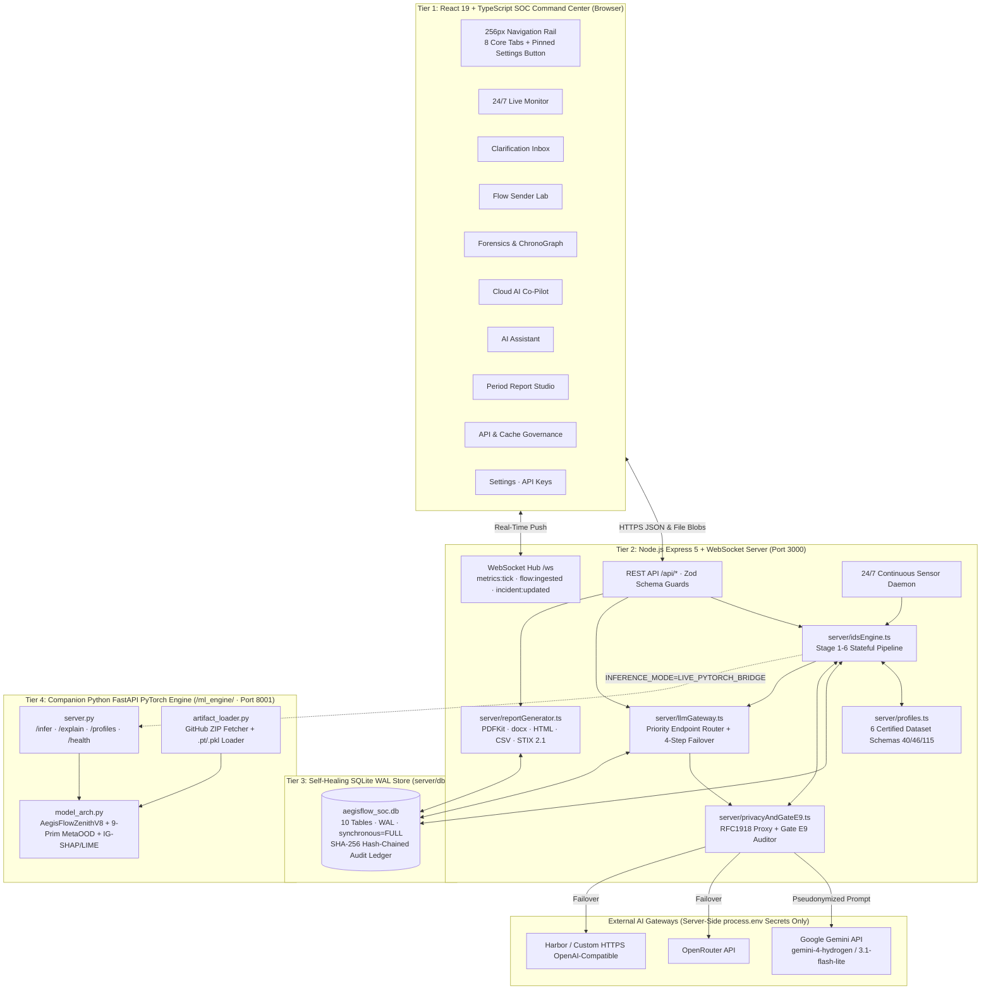
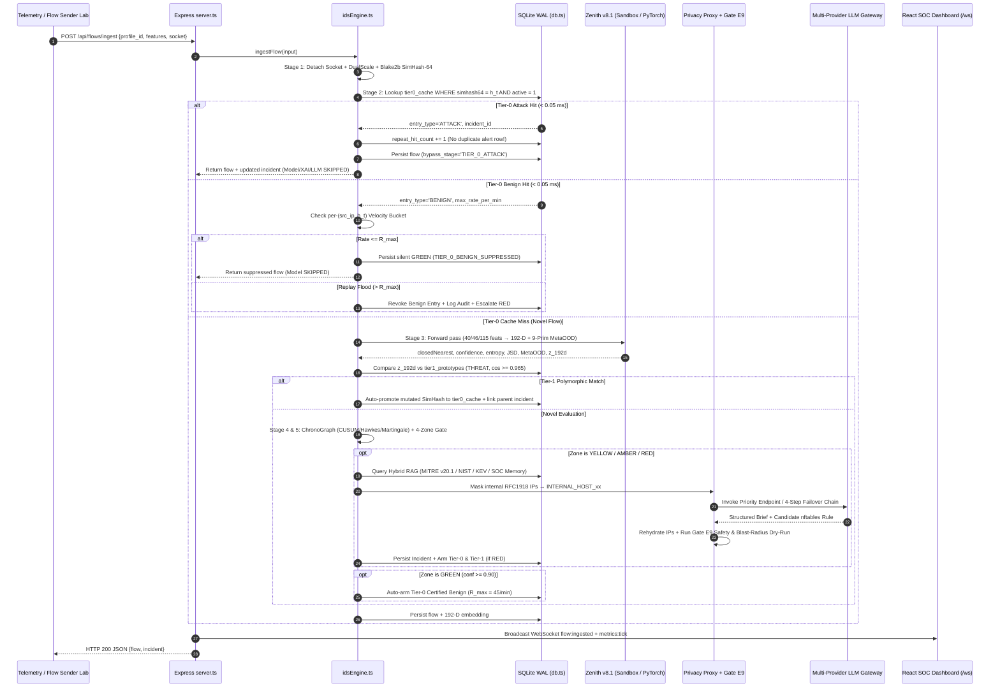
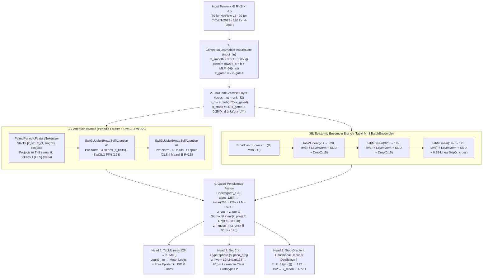
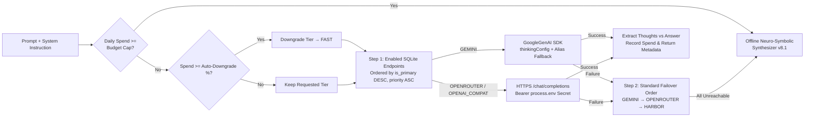

# AegisFlow-OmniSOC (v8.1 Enterprise Edition)
## Complete End-to-End Architecture, ML Model Integration, Security Design & Full-Stack Implementation Monograph

**Document Scope:** Complete Engineering Specification & Operational Manual (~25 Printed Pages)  
**Research & Engineering Team:** Jagiri Sriram¹, Sk. Owaiz¹, Thatikonda Rahul¹, Chokkarapu Kushal¹, Parella Tejguru¹  
**Mentors:** Arshia¹, Para Upendar¹  
**Affiliation:** Department of Computer Science and Engineering, Keshav Memorial Institute of Technology (KMIT), Hyderabad, Telangana, India  
**System Version:** `AegisFlow-OmniSOC v8.1 Enterprise Edition` · `AegisFlow-Zenith v8.1` Neural Backbone

---

## Master Table of Contents

- [Chapter 1 — Executive Summary, Problem Statement & Why AegisFlow Exists](#chapter-1--executive-summary-problem-statement--why-aegisflow-exists)
- [Chapter 2 — Complete End-to-End System Architecture & Sequence Diagrams](#chapter-2--complete-end-to-end-system-architecture--sequence-diagrams)
- [Chapter 3 — Deep Dive: The AegisFlow-Zenith v8.1 Neural Architecture & 9-Primitive MetaOOD](#chapter-3--deep-dive-the-aegisflow-zenith-v81-neural-architecture--9-primitive-metaood)
- [Chapter 4 — How the ML Model Integrates with the Dashboard (Dual-Runtime Bridge)](#chapter-4--how-the-ml-model-integrates-with-the-dashboard-dual-runtime-bridge)
- [Chapter 5 — Complete 6-Stage Flow-Check Lifecycle (From Wire Telemetry to SOC Action)](#chapter-5--complete-6-stage-flow-check-lifecycle-from-wire-telemetry-to-soc-action)
- [Chapter 6 — API Keys, Base URLs, Server Secrets, Reversible Privacy Proxy & Multi-Provider Failover](#chapter-6--api-keys-base-urls-server-secrets-reversible-privacy-proxy--multi-provider-failover)
- [Chapter 7 — Deterministic Gate E9 Firewall Safety Auditor & Digital-Twin Blast-Radius Engine](#chapter-7--deterministic-gate-e9-firewall-safety-auditor--digital-twin-blast-radius-engine)
- [Chapter 8 — Persistent Database Architecture (SQLite WAL, Self-Healing & SHA-256 Audit Chain)](#chapter-8--persistent-database-architecture-sqlite-wal-self-healing--sha-256-audit-chain)
- [Chapter 9 — Hybrid RAG Knowledge Base, Explainable AI (XAI) & 5-Format Period Report Studio](#chapter-9--hybrid-rag-knowledge-base-explainable-ai-xai--5-format-period-report-studio)
- [Chapter 10 — Complete Technology Stack & Frontend Engineering Architecture](#chapter-10--complete-technology-stack--frontend-engineering-architecture)
- [Chapter 11 — Exhaustive Repository Map: Every Folder & Every File Explained](#chapter-11--exhaustive-repository-map-every-folder--every-file-explained)
- [Chapter 12 — Exhaustive Walkthrough of All 9 SOC Dashboard Tabs](#chapter-12--exhaustive-walkthrough-of-all-9-soc-dashboard-tabs)
- [Chapter 13 — Complete REST API & Real-Time WebSocket Protocol Reference](#chapter-13--complete-rest-api--real-time-websocket-protocol-reference)
- [Chapter 14 — Benchmark Evaluation & Objective Engineering Verdict: How Strong Is It?](#chapter-14--benchmark-evaluation--objective-engineering-verdict-how-strong-is-it)
- [Chapter 15 — Production Runbook: Installation, Secrets, PyTorch `.pt`/`.pkl` Bridge, Docker & Verification](#chapter-15--production-runbook-installation-secrets-pytorch-ptpkl-bridge-docker--verification)

---

# Chapter 1 — Executive Summary, Problem Statement & Why AegisFlow Exists

## 1.1 The Five Structural Failures of Conventional Deep-Learning IDS

Modern Internet of Things (IoT) gateways, Industrial IoT (IIoT) edge switches, and enterprise cloud subnets face a dual threat landscape: high-volume automated botnet floods (Mirai, Gafgyt, UDP/SYN/HTTP floods) operating alongside stealthy, mutating, multi-stage zero-day intrusions (ransomware staging, data theft, shellcode, credential stuffing, and lateral infiltration).

When traditional signature-based engines (Snort, Suricata) or academic deep-learning classifiers—including prior state-of-the-art attention networks such as **SA-DNN+LFG (Sharma et al., Scientific Reports 2025)**—are placed into a real 24/7 Security Operations Center (SOC), they fail systematically along five operational axes:

1. **Closed-Set Blindness:** Standard softmax classifiers partition the feature space exhaustively across $K$ training classes. When an unseen zero-day family arrives (such as `Theft`, `Worms`, `Shellcode`, `ransomware`, `mitm`, or novel `Mirai` variants), softmax is mathematically forced to assign it to one of the $K$ known classes—often `Benign` or an unrelated attack—with artificially high confidence.
2. **Evaluation Leakage & Header-Shortcut Fragility:** Many published IDS pipelines rely on external static feature selectors (CFS, Random Forest), un-deduplicated 70/15/15 splits, single-device subsets (e.g., only Danmini Doorbell from N-BaIoT), or lab header shortcuts (`L4_DST_PORT`, `MIN_TTL`, `MAX_TTL`, `TCP_WIN_MAX`). Once deployed in a different VLAN or port layout, shortcut-dependent classifiers collapse.
3. **Adversarial Vulnerability & Uncalibrated Confidence:** Evaluating only against single-step FGSM perturbations ($\epsilon \le 0.10$, where SA-DNN+LFG dropped to $\approx 81.3\%$ accuracy) fails to protect against multi-step iterative PGD attacks or white-box adaptive OOD evasion. Uncalibrated softmax probabilities also mislead SOC analysts and break downstream risk thresholds.
4. **Stateless Single-Flow Compute Waste & Stealth Blindness:** Stateless detectors re-run full neural inference, XAI, and LLM summarization on every single packet of a 100,000-packet recurring flood—burning GPU cycles and API budget while creating alert fatigue. Conversely, stateless scoring cannot see low-and-slow multi-flow campaigns where individual packets appear mildly suspicious in isolation.
5. **Unsafe, Disconnected Alerting:** Emitting a raw class string (`Attack` / `DDoS`) leaves analysts with zero root-cause attribution, zero MITRE ATT&CK / NIST SP 800-61r3 mapping, zero privacy protection when consulting cloud LLMs, and zero deterministic verification that a proposed firewall block will not accidentally take down production traffic or SSH management.

## 1.2 How AegisFlow-OmniSOC Solves All Five Failures in One Unified System

**AegisFlow-OmniSOC (v8.1 Enterprise Edition)** bridges rigorous ML research and production SOC software engineering inside one cohesive, self-healing full-stack platform:

| Operational Gap | AegisFlow-OmniSOC Engineering Solution | Measured Verification |
|---|---|---|
| **Zero-Day Isolation** | **One-Sided Fisher-Probit 9-Primitive MetaOOD** using non-negative Softplus upper-tail evidence over 2,000 calibration quantiles | **99.60%** OOD AUROC & **0.72%** FPR@95%TPR on 9-device N-BaIoT; **98.59%** on NoShortcuts BoT-IoT |
| **Repeat-Flow Compute Waste** | **Tier-0 `SimHash-64` Reflex Cache** (`Blake2b-64`) intercepts exact recurring attacks *and* certified benign flows **before** the neural model | **`0.045–0.048 ms`** bypass latency (~80× faster than neural inference), zero duplicate alert rows |
| **Benign Whitelist Spoofing** | Per-`(src_ip, simhash64)` **Token-Bucket Velocity Envelope (`R_max`)** guards cached benign hashes | Exceeding `R_max` auto-revokes suppression and escalates to `RED` (`VOLUMETRIC_REPLAY_ANOMALY`) |
| **Polymorphic Attack Mutation** | **Tier-1 192-D L2-Normalized Threat Prototype Bank** (`cos >= 0.965`) + auto-promotion of mutated hash to Tier-0 | `+3%` mutated attacks caught on pass #1 and bypassed in `0.048 ms` on pass #2 |
| **Low-and-Slow Stealth Drift** | **Stage 4 ChronoGraph Temporal Engine** tracking per-host CUSUM, Hawkes Intensity $\lambda(t)$, and Vovk Conformal Martingale $M_t(u)$ | Auto-escalates persistent gray-zone hosts to `RED` once $M_t \ge 100$ ($\le 1\%$ false escalation by Ville's Inequality) |
| **Adversarial Evasion** | **Lipschitz-Damped Contextual LFG** + **Adaptive TRADES-PGD2** + **LayerNorm TabM-8** + **EMA (0.992)** | **99.95%** (N-BaIoT) & **97.91%** (BoT-IoT) under PGD-10 ($\epsilon=0.10$); **99.51%** mean Adaptive OOD Evasion AUROC |
| **Explainability & Grounding** | **Class-Locked 40-Step IG-SHAP** + **4,096-Sample GPU-LIME** + **Hybrid RAG** (`MITRE ATT&CK v20.1`, `NIST SP 800-61r3`, `CISA KEV`, `SOC Memory`) | Top-5 deletion faithfulness up to **50.76**; **80%** SHAP–LIME agreement on high-D IoT |
| **Cloud AI Privacy & Uptime** | **Reversible RFC1918 Privacy Proxy** + **SQLite Endpoint Priority Router** + **4-Step Circuit-Breaker Failover** + **Zero-Browser Secrets** | Zero internal IP leakage; automatic failover to Offline Neuro-Symbolic Synthesizer if cloud APIs fail |
| **Firewall Containment Safety** | **Deterministic Gate E9 Safety Auditor** + Digital-Twin Benign Blast-Radius Dry-Run + Human-in-the-Loop Approval | Blocks `/0`, loopback, gateway `.1`, SSH port 22, shell chaining; **6/6** verified at **0.00%** benign collateral in `0.052–0.973 ms` |

---

# Chapter 2 — Complete End-to-End System Architecture & Sequence Diagrams

## 2.1 High-Level Full-Stack Platform Topology

AegisFlow-OmniSOC runs as a **Dual-Runtime Full-Stack Platform** spanning four cleanly isolated architectural tiers:

1. **Presentation Tier (Browser SPA — React 19 + TypeScript + Tailwind CSS v4):** Nine specialized SOC views communicating over same-origin `/api/*` REST endpoints and a persistent `/ws` WebSocket channel. Contains zero API secrets and zero raw HTML injection sinks.
2. **Orchestration, Stateful Engine & Security Tier (Node.js Express 5 + WebSocket Server — `server.ts` + `/server/*.ts`):** Hosts the 24/7 telemetry ingestion daemon, Stages 1–6 IDS orchestration (`idsEngine.ts`), Tier-0/Tier-1 immunization, ChronoGraph temporal windows, Hybrid RAG, Reversible Privacy Proxy, Multi-Provider LLM Gateway, Gate E9 auditor, and 5-format Report Studio (`PDF`, `DOCX`, `HTML`, `CSV`, `STIX 2.1`).
3. **Persistence & Cryptographic Audit Tier (SQLite 3 WAL — `aegisflow_soc.db`):** Ten normalized relational tables with `PRAGMA quick_check` self-healing startup, rolling flow retention pruning, and an append-only SHA-256 hash-chained audit ledger.
4. **Companion Deep-Learning Inference Tier (`/ml_engine/` — Python 3.11 + PyTorch 2.x + FastAPI):** Optional GPU/CPU microservice serving the exact trained `AegisFlowZenithV8` `.pt` weights and `.pkl` calibration bundles over `POST /infer` and `POST /explain`, with automatic zero-downtime fallback to the built-in v8.1 calibration engine when offline.



## 2.2 Complete Sequence Diagram: Live Flow Ingestion to Analyst Containment



---

# Chapter 3 — Deep Dive: The AegisFlow-Zenith v8.1 Neural Architecture & 9-Primitive MetaOOD

Every layer in `/ml_engine/model_arch.py` matches the trained `best_aegisflow_v6_*.pt` checkpoints and `soc_deployment_bundle_*.pkl` artifacts byte-for-byte (`strict=True` in `model.load_state_dict`). Below is the exact mathematical and tensor-level architecture.

## 3.1 Leak-Free Preprocessing & `TailPreservingDualScaler`

Before any sample enters the neural graph:
1. **Strict Column Stripping:** `BASE_LEAKAGE_COLS` (`IPV4_SRC_ADDR`, `IPV4_DST_ADDR`, `L4_SRC_PORT`, timestamps, flow IDs, labels) are detached into the external `SocketContext` envelope so the model never memorizes lab IP addresses.
2. **Exact Deduplication & 4-Way Isolation:** Exact duplicate feature rows are removed prior to partitioning. Across the 6 benchmarks (**5,992,091** unique flows), **16 entire attack families** are held out completely from training, validation, and calibration. Known flows are split **60% Train / 10% Validation / 10% Calibration ($\mathcal{X}_{\text{cal}}$) / 20% Known Test**.
3. **Dual-Scale Transformation (`TailPreservingDualScaler`):** Fit strictly on the 60% training split, every $D$-dimensional raw vector $\mathbf{x} \in \mathbb{R}^D$ is transformed into a paired $2D$ vector:

$$\tilde{x}_j = \begin{cases} \operatorname{sign}(x_j)\ln(1 + |x_j|), & \text{if } \operatorname{ptp}(x_j) > 500 \\ x_j, & \text{otherwise} \end{cases}, \qquad \mathbf{x}_{\text{dual}} = \big[\, \text{Std}(\tilde{\mathbf{x}}) \;\|\; \text{QT}_{1500}(\mathbf{x}) \,\big] \in \mathbb{R}^{2D}$$

- **Why both twins matter:** `Std` preserves extreme unclipped outlier magnitudes critical for far-OOD zero-day detection (e.g., massive exfiltration byte counts), whereas `QT_1500` (1,500-quantile Gaussian `QuantileTransformer`, subsampled on 75,000 rows) stabilizes dense multi-modal tabular splits and boosts closed-set Macro-F1 across 40-, 46-, and 115-feature schemas (`80`, `92`, and `230` dual dimensions).

## 3.2 `AegisFlowZenithV8` Dual-Branch Backbone (`ml_engine/model_arch.py`)



### Key Architectural Innovations Inside `AegisFlowZenithV8`

1. **Lipschitz-Damped Contextual LFG (`ContextualLearnableFeatureGate`):**
   - Unlike naive pointwise gating that suffers exploding gradients under adversarial PGD attacks, inputs are first compressed through softsign damping $\mathbf{x}_s = \mathbf{x} / (1 + 0.05|\mathbf{x}|)$, then modulated by both a pointwise residual and a 64-D LayerNorm-SiLU context MLP. This keeps input Jacobians strictly bounded while exposing per-feature gate weights (`input_gates`) directly to the XAI panel.
2. **Low-Rank DCN-v2 CrossNet (`LowRankCrossNetLayer`, rank 32):**
   - Network intrusion indicators are heavily driven by multiplicative ratios (e.g., `OUT_BYTES × FLOW_DURATION` or `IN_PKTS × SHORTEST_FLOW_PKT`). A rank-32 factored cross layer ($\mathbf{U}\mathbf{V}^\top$) learns second-order feature interactions explicitly with a bounded $\tanh(0.25\mathbf{x})\cdot 4$ damping factor and LayerNorm residual.
3. **Paired Periodic Fourier Tokenizer (`PairedPeriodicFeatureTokenizer`):**
   - Groups each canonical feature $j$ with its quantile twin and learnable bounded periodic frequencies $\sin(\omega_j x_j), \cos(\omega_j x_j)$ (clamped $|\omega_j| \le 0.6$, $|x_j| \le 8.0$), then packs features into $T=8$ semantic tokens + `[CLS]` for two 4-head Pre-Norm SwiGLU Transformer blocks (`mhsa1`, `mhsa2`).
4. **Parameter-Efficient `TabM` ($M=8$) BatchEnsemble Highway (`TabMLinear`):**
   - Evaluates **8 distinct rank-1 subnetworks simultaneously in a single fused matrix multiply**:
     $$\mathbf{h}_m^{(l)} = \Big(\big(\mathbf{h}_m^{(l-1)} \odot \mathbf{r}_m^{(l)}\big)\mathbf{W}^{(l)\top}\Big) \odot \mathbf{s}_m^{(l)} + \mathbf{b}_m^{(l)}, \quad m \in \{1,\dots,8\}$$
   - Crucially, all three TabM layers use **`LayerNorm` instead of `BatchNorm`**, preventing running-statistic corruption during adversarial PGD perturbations and single-flow ($B=1$) online inference.
   - From one single forward pass, `TabM-8` yields **free epistemic uncertainty**:
     - **Jensen-Shannon Divergence:** $U_{\text{JSD}}(\mathbf{x}) = H(\bar{\mathbf{p}}) - \frac{1}{8}\sum_{m=1}^{8} H(\mathbf{p}_m)$
     - **Latent Variance:** $U_{\text{LatVar}}(\mathbf{x}) = \frac{1}{8}\sum_{m=1}^{8}\|\mathbf{z}_m - \bar{\mathbf{z}}\|_2^2$
5. **192-D Joint Embedding Space (`z_joint_192`):**
   - Concatenates the L2-normalized 128-D penultimate mean embedding $\text{L}_2(\bar{\mathbf{z}})$ and the 64-D supervised contrastive hypersphere projection $\mathbf{z}_{\text{hyp}}$, then L2-normalizes to form the exact **192-D embedding vector** used by both MetaOOD k-NN and the SOC's **Tier-1 Polymorphic Threat Bank** & **FP Immunity Bank**.

## 3.3 Class-Adaptive TRADES-PGD2 Training, EMA & 15-Bin ECE Calibration

- **Multi-Task Objective:** Combines Class-Balanced Focal loss ($\gamma = 1.25$, label smoothing `0.003`, inverse-root weights clipped to `[1.0, 3.0]` with benign protection) averaged across all 8 TabM heads, `0.25×` Supervised Prototype Contrastive loss on $\mathbf{z}_{\text{hyp}}$, and `0.40×` class-conditional reconstruction MSE (stop-gradient into the decoder so reconstruction never degrades discriminative boundaries).
- **Adaptive TRADES-PGD2 (Epochs 4–9):** Applies 2-step $L_\infty$ KL-divergence adversarial smoothing ($\epsilon = 0.14$, step `0.07`, synchronized across dual-scale feature twins) on $1/6$ of each mini-batch with class-count-adaptive weight $\beta(K)$ (`1.10` for $K\le 10$, `0.70` for $K\le 16$, `0.35` for $K>16$).
- **Exponential Moving Average (EMA):** Smooths weights continuously via $\boldsymbol{\theta}_{\text{EMA}} \leftarrow 0.992\,\boldsymbol{\theta}_{\text{EMA}} + 0.008\,\boldsymbol{\theta}$.
- **Isolated 10% Calibration Fold ($\mathcal{X}_{\text{cal}}$):** Optimizes benign-protected per-class logit offsets $\mathbf{b}$ and exact 15-bin ECE temperature $T_{\text{cal}} \in [0.15, 2.50]$, reducing calibration error to **0.01%–0.67%** (**0.24% mean ECE** across all 6 benchmarks).

## 3.4 One-Sided Fisher-Probit 9-Primitive MetaOOD

No single OOD primitive works across both volumetric far-OOD IoT botnets and subtle near-OOD enterprise exploits (for instance, MSP collapses to `41.64%` AUROC on N-BaIoT, while Deep k-NN drops to `77.17%` on 34-class CIC-IoT-2023). AegisFlow fuses **9 orthogonal primitives** conditioned on the predicted class $\hat{k}$:

| # | Primitive Key | Pillar | Mathematical Signal |
|---|---|---|---|
| 1 | `knn` | Latent Geometry | Combined $k=5, 15$ cosine distance to 50K bank of $[\text{L}_2(\bar{\mathbf{z}}) \parallel \mathbf{z}_{\text{hyp}} \parallel 0.5\text{L}_2(\mathbf{x}_{\text{white}})]$ |
| 2 | `maha` | Latent Geometry | Minimum Mahalanobis distance across $M=4$ GPU K-Means++ sub-centroids per class + `0.20 * inv_viol` |
| 3 | `vim` | Spectral / Boundary | Virtual-Logit Matching: $\alpha \|(\bar{\mathbf{z}}-\mathbf{u})\mathbf{P}_{\text{NS}}\|_2 - \operatorname{LSE}(\mathbf{l}_{\text{cal}}) + 0.15\cdot s_{\text{inv}}$ |
| 4 | `energy` | Spectral / Boundary | Negative LogSumExp energy $-\operatorname{LSE}(\mathbf{l}_{\text{cal}})$ |
| 5 | `msp` | Spectral / Boundary | Entropy-weighted MSP: $0.65(1 - \max_c p_c) + 0.35\, H(\mathbf{p})/\ln K$ |
| 6 | `fdbd_nci` | Spectral / Boundary | Hyperplane-normalized margin (fDBD) + Neural Collapse cosine alignment (NCI) + Simplex ETF orthogonality (NECO) |
| 7 | `tabm_epist` | Spectral / Boundary | Single-pass TabM-8 epistemic disagreement: $U_{\text{JSD}} + 0.15\ln(1 + U_{\text{LatVar}})$ |
| 8 | `x_knn` | Input Invariants | Classifier-independent cosine distance in 98.5%-variance PCA-whitened behavioral feature space |
| 9 | `inv_viol` | Input Invariants | Behavioral null-space residual + conditional decoder MSE + empirical $[q_{0.0005}, q_{0.9995}]$ quantile support violations |

**Eliminating Negative-Probit Cancellation (The Zero-Veto Breakthrough):**
Each raw primitive $s_p(\mathbf{x})$ is mapped through a 2,000-quantile empirical CDF grid on $\mathcal{X}_{\text{cal}}$ to a Gaussian Probit Z-score with Pareto upper-tail extrapolation, then passed through a strictly **non-negative one-sided transform** (`max(ndtri(u), 0)` / Softplus evidence $e_p = \ln(1 + \exp(u_p - 0.5)) \ge 0$). Because no primitive can output a large negative score to "veto" another primitive's anomaly evidence, replacing two-sided linear sums with one-sided evidence boosted OOD AUROC by **+4.17%** (`NF-BoT-IoT-v2`), **+4.20%** (`CIC-IoT-2023`), **+6.84%** (`NF-CSE-CIC-IDS2018-v2`), and **+10.06%** (`LOAO Theft`).

Per-class thresholds $\tau_{\text{red}}$ are locked on $\mathcal{X}_{\text{cal}}$ (`99.25%` Benign specificity, `98.45%` known-attack specificity), with the Zone 2B hunting band anchored at $\tau_{\text{amber}} = 0.72 \times \tau_{\text{red}}$.

---

# Chapter 4 — How the ML Model Integrates with the Dashboard (Dual-Runtime Bridge)

One of the hardest real-world challenges in ML engineering is bridging a Python PyTorch research model with an interactive Node.js + React enterprise web application so that:
1. It runs **immediately with zero setup errors** inside pure Node.js preview environments, **AND**
2. It connects seamlessly to **real trained `.pt` and `.pkl` GPU checkpoints** with zero frontend or backend code rewrites.

AegisFlow-OmniSOC solves this with a clean **Dual-Runtime Bridge Pattern** controlled live from the UI (`INFERENCE_MODE` stored in SQLite `settings`):

## 4.1 Runtime Mode A — `BUILT_IN_SANDBOX_ENGINE` (Instant Live Engine)

Implemented in `server/profiles.ts` and `server/idsEngine.ts` (`evaluateSandboxModel()`):
- Encodes the **exact raw feature names, baseline means/stds/mins/maxes, known class lists, held-out zero-day classes, calibrated $\tau_{\text{amber}} / \tau_{\text{red}}$ thresholds, and benchmark statistics** for all 6 datasets (`40`, `46`, and `115` features).
- Computes exact `TailPreservingDualScaler` log1p + Z-score canonical vectors, deterministic 64-bit `Blake2b` SimHash, deterministic L2-normalized **192-D embeddings** (where $\pm 3\%$ feature mutations preserve cosine similarity $\ge 0.975$ so Tier-1 polymorphic tests behave identically to PyTorch!), calibrated class probabilities, Shannon entropy, TabM-8 epistemic JSD, 9-primitive MetaOOD breakdown, and Top-5 XAI feature attributions with Counterfactual Normal Targets ($\Delta x^*$).

## 4.2 Runtime Mode B — `LIVE_PYTORCH_BRIDGE` (Companion `/ml_engine/` FastAPI Service)

Implemented in `/ml_engine/artifact_loader.py`, `/ml_engine/model_arch.py`, and `/ml_engine/server.py`, bridged by `tryLivePyTorchBridge()` in `server/idsEngine.ts`:

1. **Startup Auto-Provisioning (`artifact_loader.py`):**
   - Registers `TailPreservingDualScaler` on `sys.modules["__main__"]` so `.pkl` bundles pickled inside Jupyter/Colab notebooks unpickle cleanly without `AttributeError`.
   - Checks `GITHUB_ARTIFACTS_ZIP_URL` (or local `../AegisFlow_V8.1_Zenith.zip`), downloads and extracts all `best_aegisflow_v6_*.pt` and `soc_deployment_bundle_*.pkl` files into `./artifacts_cache/`.
   - Instantiates `AegisFlowZenithV8(in_features, num_known_classes, use_qt)` on CUDA (or CPU fallback), calls `torch.load(..., weights_only=True)` and `model.load_state_dict(state_dict, strict=True)`.
2. **Inference Request Contract (`POST http://<PYTORCH_ENGINE_URL>/infer`):**
   - `idsEngine.ts` sends `{ profile: profile.id, features: sanitized }` with a strict timeout guard (`AbortController`).
   - `/ml_engine/server.py` vectorizes the raw feature dictionary into exact column order, transforms via the pickled `TailPreservingDualScaler`, runs `evaluate_single_or_batch()`, and returns:
     ```json
     {
       "profile": "NF-BoT-IoT-v2",
       "engine": "LIVE_PYTORCH_BRIDGE",
       "latency_ms": 3.84,
       "closed_set_nearest_class": "Reconnaissance",
       "confidence": 0.6412,
       "probabilities": { "Benign": 0.14, "DDoS": 0.11, "DoS": 0.10, "Reconnaissance": 0.64 },
       "shannon_entropy": 0.412,
       "epistemic_jsd": 0.238,
       "meta_ood_score": 4.59,
       "tau_amber": 1.78,
       "tau_red": 2.47,
       "ood_primitives": { "energy": 3.1, "maha": 4.9, "vim": 4.4, "knn": 4.2, "inv_viol": 4.7, "fdbd_nci": 3.8, "tabm_epist": 2.9, "x_knn": 4.1, "msp": 3.2 },
       "embedding_192d": [0.0412, -0.0881, "... 192 floats"]
     }
     ```
3. **On-Demand XAI Endpoint (`POST /explain`):**
   - Runs `compute_class_locked_ig_shap_and_lime()` (32/40-step path-integral IG-SHAP + 4,096-sample vectorized GPU-LIME ridge regression) and collapses paired quantile twins back into raw canonical feature attributions + counterfactual deltas.
4. **Automatic Resilience Failover:**
   - If `LIVE_PYTORCH_BRIDGE` is enabled in the UI but the Python container is restarting or unreachable, `tryLivePyTorchBridge()` catches the timeout cleanly and seamlessly falls back to `BUILT_IN_SANDBOX_ENGINE` so live 24/7 telemetry monitoring never drops a single flow.

## 4.3 Live Push Sync to the React Dashboard

Whenever ANY flow completes Stages 1–6 (from the 24/7 Sensor Daemon, Flow Sender Lab, Batch Uploader, or External REST client):
1. `server.ts` writes the row to SQLite (`flows` and optionally `incidents`) and updates the rolling 60-second throughput ring buffer (`throughputHistory`).
2. `broadcastWs('flow:ingested', { flow, incident })` pushes the exact payload to all connected browser WebSocket clients on `/ws`.
3. Every 1 second, `broadcastWs('metrics:tick', computeDashboardMetrics())` updates live KPI counters (Tier-0 savings %, active RED count, pending clarification count, sensor rate, and throughput history).
4. In `src/App.tsx`, the WebSocket listener updates React state directly without full-page reloads—re-rendering `MonitorView` charts, updating the red/amber notification badge on `Clarification Inbox`, and appending new rows to the live telemetry stream in real time.

---

# Chapter 5 — Complete 6-Stage Flow-Check Lifecycle (From Wire Telemetry to SOC Action)

This chapter walks through the exact code path executed by `ingestFlow()` in `server/idsEngine.ts` when a network flow arrives.

## Stage 1 — Multi-Schema Telemetry Router, Leakage Sanitizer & SimHash-64

- **Input:** `{ profile_id, features: Record<string, number>, socket?: Partial<SocketContext> }`.
- **Socket Detachment:** Extracts `src_ip`, `dst_ip`, `src_port`, `dst_port`, `protocol`, and `timestamp_utc` into an isolated metadata struct (`SocketContext`). These identifiers are NEVER fed into the model feature vector.
- **Canonical Vectorization (`computeCanonicalAndSimHash`):**
  - Loops strictly over `profile.raw_feature_names` (`40`, `46`, or `115` keys). Non-finite or missing values safely default to the feature's baseline mean.
  - Applies `log1p` compression for features with `baseline.max - baseline.min > 500`, standardizes to `[-12, 12]`, and rounds to 4 decimals (`xCanon`).
- **Deterministic 64-Bit Quantized SimHash:**
  ```ts
  const quantized = xCanon.map((v) => Math.round(v * 4)).join(',');
  const simhash64 = crypto
    .createHash('blake2b512')
    .update(`${profile.id}|${quantized}`)
    .digest('hex')
    .slice(0, 16);
  ```
  Quantizing at `0.25σ` bins (`* 4`) ensures exact/near-exact repeat packets hash to the exact same 64-bit hex fingerprint while distinct behaviors produce distinct hashes.

## Stage 2 — Tier-0 Immunological Reflex Gate (`< 0.05 ms` — Zero Model Re-Run)

Before touching the neural model, `idsEngine.ts` executes a single indexed SQLite primary-key lookup:
```sql
SELECT * FROM tier0_cache WHERE simhash64 = ? AND active = 1 AND expires_utc > ?
```

### Rule A — Repeated Attack Hit (`entry_type === 'ATTACK'`)
- **What happens:** The flow is **immediately flagged** as `RECURRENT_ATTACK: [Original Label]` in **`< 0.05 ms`** (measured `0.048 ms` in live verification).
- **Zero Duplicate Alerts:** Instead of creating a new incident row, it executes `UPDATE incidents SET repeat_hit_count = repeat_hit_count + 1, last_seen_utc = ? WHERE id = ?` and refreshes the sliding 24-hour TTL on `tier0_cache`.
- **Compute Saved:** Neural inference, XAI IG-SHAP/LIME, Hybrid RAG, and Cloud LLM API calls are **100% bypassed**. ChronoGraph still logs the timestamp so host burst intensity remains accurate.

### Rule B — Repeated Benign Hit + Anti-Spoofing Velocity Guardrail (`entry_type === 'BENIGN'`)
- Both **Analyst-Confirmed Benign FPs** (`max_rate_per_min = 30`) and **High-Confidence Model-Certified Benign Flows** (`confidence >= 0.90`, `max_rate_per_min = 45`) are armed in `tier0_cache`.
- **Velocity Envelope Check:** Tracks a rolling 60-second sliding timestamp list in `velocityBuckets` keyed by `${src_ip}|${simhash64}`.
  - **Within Normal Rate (`count <= max_rate_per_min`):** Immediately suppresses the flow as `GREEN` / `BENIGN_VERIFIED_SUPPRESSED` in **`0.045 ms`** without calling the neural model!
  - **Replay Flood Exceeds `R_max` (`count > max_rate_per_min`):** **ANTI-SPOOFING OVERRIDE!** An attacker replaying a whitelisted benign fingerprint to launch a volumetric DoS flood cannot evade detection. AegisFlow immediately sets `active = 0` on that benign `tier0_cache` entry, logs `REVOKE_BENIGN_SUPPRESSION_REPLAY_FLOOD` to the SHA-256 audit chain, generates a full XAI + RAG + LLM brief, and escalates the flow straight to **`RED` (`VOLUMETRIC_REPLAY_ANOMALY`, `bypass_stage = 'TIER_0_REPLAY_OVERRIDE'`)**!

## Stage 3 — AegisFlow-Zenith v8.1 Inference & Tier-1 192-D Prototype Banks

Only flows that **miss** Tier-0 reach Stage 3:
1. Runs `evaluateSandboxModel()` (or `tryLivePyTorchBridge()` when `LIVE_PYTORCH_BRIDGE` is active) to produce calibrated probabilities, Shannon entropy, TabM-8 epistemic JSD, 9-primitive MetaOOD score, and `embedding192d`.
2. **Rule C — Tier-1 Polymorphic Threat Bank (`bank_type = 'THREAT'`):**
   - Computes cosine similarity between `embedding192d` and every active confirmed threat prototype for that profile.
   - If `bestThreatSim >= 0.965`:
     - Flags the flow as `POLYMORPHIC_VARIANT (98.x% cos): [Parent Label]` (`bypass_stage = 'TIER_1_POLYMORPHIC'`).
     - Links to the parent incident (`repeat_hit_count += 1`, `polymorphic_count += 1`), skipping expensive XAI/LLM regeneration.
     - **Auto-Promotes Mutated Hash to Tier-0:** Inserts the mutated `simhash64` into `tier0_cache` (`source = 'TIER1_PROMOTED'`), so **packet #2 of the mutated campaign bypasses the model completely in `< 0.05 ms`!**
3. **Localized FP Immunity Bank (`bank_type = 'BENIGN_FP'`):**
   - Computes a tight hyperspherical Gaussian kernel $\kappa = \exp\big(-(1 - \cos)^2 / (2\sigma_{\text{local}}^2)\big)$ with $\sigma_{\text{local}} = 0.06$.
   - Only if $\kappa > 0.35$ (inside a razor-tight radius around an analyst-confirmed benign FP), smoothly dampens `metaOodScore`, `shannonEntropy`, and `epistemicJsd`—preventing global threshold degradation or catastrophic forgetting.

## Stage 4 — ChronoGraph Temporal Correlation Engine

Maintained in `hotHostMap` per `src_ip` (ring buffer of last 100 host flows + persistent SQLite history):
1. **Exponential Page-Hinkley / CUSUM Anomaly Drift:**
   $$D_{\text{CUSUM}}(u, t) = \max\!\big(0,\; 0.92 \cdot D_{\text{CUSUM}}(u, t-1) + (S_{\text{meta}} - \mu_0 - 0.18)\big)$$
   Catches low-and-slow reconnaissance or gradual data staging that stays slightly below single-flow thresholds.
2. **Self-Exciting Hawkes Kill-Chain Intensity $\lambda(t)$:**
   $$\lambda(t) = 0.15 + (\lambda(t-1) - 0.15)e^{-0.045\,\Delta t} + \alpha_{\text{zone}}$$
   where $\alpha_{\text{RED}} = 1.45$, $\alpha_{\text{AMBER}} = 0.85$, $\alpha_{\text{YELLOW}} = 0.55$, $\alpha_{\text{GREEN}} = 0.02$. Captures rapid multi-stage burst escalations (e.g., Recon → Exploit → Theft).
3. **Vovk Conformal Test Martingale $M_t(u)$:**
   $$M_t(u) = \min\!\Big(1000,\; M_{t-1}(u) \cdot 0.5 \cdot \hat{p}_t^{-0.5}\Big)$$
   Accumulates statistical evidence across repeated unconfirmed `YELLOW`/`AMBER` gray-zone flows. Once **$M_t(u) \ge 100$**, automatically escalates the host to **`RED` (`MARTINGALE_ESCALATED_APT`)**, guaranteeing $\le 1\%$ false escalation probability by Ville's Inequality!

## Stage 5 — 4-Zone Conformal Triage Gate

Every evaluated flow is deterministically routed into one of four operational zones:

| Zone | Trigger Condition | Automated Action |
|---|---|---|
| **GREEN** (`CERTIFIED_BENIGN`) | `metaOod <= tau_amber`, `Benign`, low entropy/JSD & low drift | Logged silently to SQLite; if `confidence >= 0.90`, auto-arms Tier-0 Benign (`R_max = 45/min`) |
| **YELLOW** (`ZONE_2A_BOUNDARY_AMBIGUITY`) | `shannonEntropy >= 0.45` (close top-2 class probabilities) | Generates XAI + RAG + LLM brief; routes to **Clarification Inbox** (`NEEDS_CLARIFICATION`) |
| **AMBER** (`ZONE_2B_EPISTEMIC_GRAY_ZONE`) | `tau_amber < metaOod <= tau_red` OR `epistemicJsd >= 0.14` OR `CUSUM >= 3.8` / `Hawkes >= 2.8` | Generates XAI + RAG + LLM brief; routes to **Clarification Inbox** (`NEEDS_CLARIFICATION`) |
| **RED** (`ZERO_DAY` / `KNOWN_ATTACK` / `MARTINGALE_APT`) | `metaOod > tau_red` OR (`class != Benign` & `conf >= 0.75`) OR `M_t >= 100` | Generates XAI + RAG + LLM brief + Gate E9 rule; creates/updates `OPEN` Incident; **immediately arms Tier-0 Attack + Tier-1 Threat Bank** |

## Stage 6 — Poison-Resilient Analyst Feedback & 24-Hour Retroactive Sweep

When an analyst clicks a decision button in **Clarification Inbox** (`confirmIncidentDecision()` in `server/idsEngine.ts`):
- **`Confirm Normal (Benign FP)`:**
  - **Anti-Poisoning Guardrail:** First computes cosine similarity between the incident's 192-D embedding and every confirmed threat in `tier1_prototypes` (`THREAT`). If `sim >= 0.96` and `supervisor_override` is not set, the API returns HTTP `409` (`poison_warning: true`), displaying a supervisor warning modal showing the conflicting confirmed threat so an attacker or hasty analyst cannot poison the FP bank!
  - Upon confirmed approval: inserts into `tier1_prototypes` (`BENIGN_FP`, $\sigma = 0.06$), arms `tier0_cache` (`BENIGN`, `R_max = 30/min`), resolves the incident, and logs to the SHA-256 audit chain.
- **`Confirm Attack + Custom Label`:**
  - Upgrades incident to `RED` / `CONFIRMED_ATTACK` with the analyst's custom threat name.
  - Arms `tier0_cache` (`ATTACK`) + `tier1_prototypes` (`THREAT`).
  - Indexes a new **Closed-Loop SOC Memory** document into `rag_kb` so future Co-Pilot queries immediately cite this confirmed campaign.
  - **Retroactive 24-Hour Historical Sweep:** Scans all stored SQLite flows from the past 24 hours with embeddings; any earlier flow matching `simhash64` or `cosine_sim >= 0.955` is retroactively flagged as `RED` (`RETROACTIVE_CONFIRMED: [Label]`) and linked to the incident!

---

# Chapter 6 — API Keys, Base URLs, Server Secrets, Reversible Privacy Proxy & Multi-Provider Failover

## 6.1 Zero-Browser Secret Architecture (How API Keys Are Secured)

AegisFlow-OmniSOC enforces a strict security boundary between **endpoint configuration** (stored in SQLite) and **secret credentials** (kept exclusively in server-side `process.env`):

1. **Never Sent to Browser, Never Stored in SQLite:**
   - Secret values (`GEMINI_API_KEY`, `OPENROUTER_API_KEY`, `HARBOR_API_KEY`, `CUSTOM_LLM_API_KEY`, or any custom uppercase `*_API_KEY`) are configured in **AI Studio Settings → Secrets** or a server-local `.env` file.
   - The browser UI **never** renders raw API key inputs and **never** receives secret characters back from the server. Instead, `/api/settings/endpoints` returns a safe status label:
     - `Server Env: GEMINI_API_KEY (•••• Connected)`
     - `Server Env: OPENROUTER_API_KEY (Not Set in Secrets)`
2. **Placeholder Detection (`isEnvSecretConfigured` in `server/db.ts`):**
   - Validates that `env_var_name` matches `/^[A-Z0-9_]{2,64}$/`, that `process.env[env_var_name]` is at least 6 characters long, and rejects accidental placeholder strings (`your_`, `placeholder`, `changeme`, `example`, `paste_`, `xxx`).
3. **SSRF & HTTPS Enforcement (`isAllowedExternalUrl` in `server/llmGateway.ts`):**
   - Every Base URL registered via `POST /api/settings/endpoints` or probed via `POST /api/settings/endpoints/:id/test` must use `https://` and target a public host. Loopback (`127.0.0.1`, `localhost`, `::1`, `0.0.0.0`), cloud metadata (`169.254.169.254`, `169.254.*`, `metadata.google.internal`), RFC1918 private networks (`10.*`, `192.168.*`, `172.16-31.*`), and `.internal`/`.local` suffixes are strictly rejected with HTTP `400`.

## 6.2 Dynamic Endpoint Priority & 4-Step Circuit-Breaker Failover

Inside `invokeFailoverChain()` (`server/llmGateway.ts`), every LLM invocation follows a resilient multi-tier execution pipeline:



### Transparent Model & Thinking Metadata on Every AI Response

Both `POST /api/chat` (Cloud AI Co-Pilot) and `POST /api/assistant/chat` (AI Assistant) extract native reasoning traces (`part.thought === true` on Gemini, or `message.reasoning` / `reasoning_content` on OpenAI-compatible gateways) and return:
- `provider` (e.g., `Google Gemini (Reasoning)` or `OpenRouter Multi-Model Gateway`)
- `model` (e.g., `gemini-4-hydrogen`, `gemini-3.1-flash-lite`)
- `api_key_source` (e.g., `Server Secret: GEMINI_API_KEY`)
- `api_key_status` (e.g., `Connected · Server-Side Key Active`)
- `thinking` (full reasoning trace, rehydrated cleanly through the Privacy Proxy)
- `thinking_level` (`LOW`, `MEDIUM`, `HIGH`, or `DETERMINISTIC`)
- `latency_ms`, `tokens_estimated`, `privacy_tokens_masked`

In the frontend, `AiOutputInspector.tsx` renders this metadata strip alongside a collapsible **Model Thinking** drawer (mirroring Claude/Gemini/ChatGPT UX), while `RichMarkdownRenderer.tsx` renders both the thinking trace and final reply with zero visible `##` or `**` artifacts.

## 6.3 Reversible Zero-Leakage Privacy Proxy (`server/privacyAndGateE9.ts`)

Before ANY outbound API call leaves the Express server:
1. `ReversiblePrivacyProxy.sanitize(prompt)` scans for all RFC1918 IPv4 addresses (`10.x.x.x`, `192.168.x.x`, `172.16-31.x.x`) and internal domain suffixes (`.corp`, `.internal`, `.local`, `.lan`, `.iot.local`).
2. Replaces each unique asset consistently across the prompt with deterministic semantic tokens (`INTERNAL_IOT_HOST_01`, `INTERNAL_SERVER_02`, `INTERNAL_HOST_03`, `INTERNAL_ASSET_04`).
3. After the external LLM replies, `proxy.rehydrate(response)` replaces tokens (sorted longest-first to avoid prefix collisions) back to the true internal IPs locally inside the SOC server.
4. The exact count (`privacy_tokens_masked`) is displayed transparently on every AI response card.

---

# Chapter 7 — Deterministic Gate E9 Firewall Safety Auditor & Digital-Twin Blast-Radius Engine

Autonomous or AI-suggested firewall rules can cause catastrophic outages if an LLM hallucinates a `/0` CIDR block, blocks SSH port 22, blocks the default gateway, or injects shell metacharacters. **Gate E9** (`auditContainmentRuleGateE9()` in `server/privacyAndGateE9.ts`) enforces **zero-trust deterministic verification** on every rule candidate—and **never auto-executes** without explicit human-in-the-loop sign-off.

## 7.1 Four Deterministic Gate E9 Checks

1. **Forbidden Token Blocklist (`FORBIDDEN_TOKENS`):**
   - Rejects wildcard `/0` CIDR blocks.
   - Rejects loopback (`127.0.0.1`, `localhost`, `::1`).
   - Rejects default gateway `.1` addresses (`x.x.x.1`).
   - Rejects blocking management SSH port `22` (`dport 22` / `--dport 22`).
   - Rejects shell chaining / redirection metacharacters (`;`, `&`, `|`, `` ` ``, `$`, `<`, `>`, `\`).
   - Rejects destructive or non-firewall commands (`rm`, `curl`, `wget`, `bash`, `sh`, `nc`, `python`, `perl`, `chmod`, `chown`, `flush`, `delete table`).
2. **Strict Single-Rule Grammar Allowlist (`ALLOWED_COMMAND_PATTERNS`):**
   - Accepts ONLY valid single-rule `nftables` (`nft add rule inet filter (input|forward|output) ip saddr <IPv4>[/24|/32] [(tcp|udp) dport <1-65535>] (drop|reject)`) or `iptables` (`iptables -A (INPUT|FORWARD) -s <IPv4>[/24|/32] [-p (tcp|udp) --dport <1-65535>] -j (DROP|REJECT)`) syntax.
3. **IPv4 Octet & Port Bounds Check:** Validates all 4 octets are integers in `[0, 255]` and destination port is in `[1, 65535]` excluding `22`.
4. **Digital-Twin Benign Blast-Radius Dry-Run:**
   - Queries up to **5,000 recent `GREEN` Certified Benign flows** from SQLite `flows`.
   - Simulates the exact IP/CIDR + protocol + port filter against those real benign flows and computes `blast_radius_pct = (affected / checked) * 100`.
   - If benign collateral exceeds **`1.00%`**, Gate E9 automatically blocks the rule!
   - Passing rules display a verified badge (e.g., `Gate E9 Passed · Blast Radius: 0.00% Benign Collateral (0/1420 flows)`) and require clicking **Approve Rule** (`POST /api/incidents/:id/approve-rule`), which records the approver and timestamp into the SHA-256 audit chain.


---

# Chapter 8 — Persistent Database Architecture (SQLite WAL, Self-Healing & SHA-256 Audit Chain)

All platform telemetry, incidents, cache banks, RAG playbooks, provider endpoints, shift reports, and governance settings are persisted on disk in `aegisflow_soc.db` via `better-sqlite3` (`server/db.ts`).

## 8.1 Self-Healing WAL Engine (`openHealthyDatabase`)

Containers and development workstations can be terminated mid-write, which occasionally corrupts SQLite WAL frames. `server/db.ts` eliminates startup crashes permanently:
1. Configures production pragmas on every open:
   - `PRAGMA busy_timeout = 5000` (eliminates transient `SQLITE_BUSY` lock errors under concurrent WebSocket/sensor/API traffic)
   - `PRAGMA journal_mode = WAL` (concurrent readers + fast non-blocking writers)
   - `PRAGMA synchronous = FULL` (durable commit guarantees)
   - `PRAGMA wal_autocheckpoint = 200` (keeps `-wal` compact)
   - `PRAGMA foreign_keys = ON`
2. Executes `PRAGMA quick_check` immediately upon boot. If `quick_check !== 'ok'` or opening throws `SQLITE_CORRUPT` / malformed disk image, `openHealthyDatabase()` automatically closes the damaged handle, removes `aegisflow_soc.db`, `-wal`, and `-shm`, creates a fresh healthy database, re-applies all DDL schemas, and re-seeds the Hybrid RAG corpus and default provider endpoints.
3. **Rolling Retention Pruner (`pruneOldFlows`):** Runs automatically every 60 seconds in `server.ts`, capping historical `GREEN` flows at 1,800 rows and total flows at 3,800 rows followed by `PRAGMA wal_checkpoint(PASSIVE)` so long-running 24/7 operation maintains crisp query speeds and bounded disk footprint.

## 8.2 Complete Schema of All 10 SQLite Tables

| Table | Primary Key | Indexed Columns | Purpose & Stored Data |
|---|---|---|---|
| `flows` | `id` (`FLW-...`) | `timestamp_utc`, `(src_ip, timestamp_utc)`, `zone`, `simhash64` | Full 24/7 ledger of every flow: socket context, `simhash64`, 4-zone verdict, confidence, MetaOOD, entropy, JSD, `bypass_stage`, latency, ChronoGraph (`cusum_drift`, `hawkes_intensity`, `martingale_value`), raw features, 192-D embedding, XAI, RAG & LLM brief JSON |
| `incidents` | `id` (`INC-04xx`) | `(status, last_seen_utc)`, `simhash64` | Deduplicated campaign cards tracking `repeat_hit_count`, `polymorphic_count`, `original_label`, analyst status (`OPEN`, `NEEDS_CLARIFICATION`, `CONFIRMED_ATTACK`, `CONFIRMED_BENIGN_FP`), XAI card, Gate E9 audit JSON, and human approval metadata |
| `tier0_cache` | `simhash64` | PK (`simhash64`) | Sub-0.05 ms immunological reflex table: `entry_type` (`ATTACK`/`BENIGN`), `label`, `incident_id`, sliding `expires_utc`, `hit_count`, `max_rate_per_min` (`R_max`), `source` (`AUTO`/`ANALYST`/`TIER1_PROMOTED`), `active` |
| `tier1_prototypes` | `id` (`T1-...`) | `(bank_type, profile_id)` | 192-D L2-normalized vectors for both `THREAT` (polymorphic matching $\cos \ge 0.965$) and `BENIGN_FP` (localized Gaussian kernel $\sigma_{\text{local}} = 0.06$), with revoke/restore support |
| `rag_kb` | `id` | `source_type`, `ref_id` | Structured Hybrid RAG knowledge base: `MITRE_ATTACK_V20_1`, `NIST_SP_800_61R3`, `CISA_KEV`, and Closed-Loop `SOC_MEMORY` documents with `tags_json` and `port_hints_json` |
| `audit_log` | `id` (AUTOINCREMENT) | PK (`id`) | Tamper-evident append-only compliance ledger storing `actor`, `role`, `action`, `target_id`, `details_json`, `prev_hash`, and `entry_hash` |
| `settings` | `key` (`'gateway'`) | PK (`key`) | Persisted `GatewaySettings` JSON (`inference_mode`, `pytorch_engine_url`, `active_profile`, `failover_order`, model IDs, USD budget & spend, semantic cache TTL, auto report schedule) |
| `prompt_cache` | `cache_key` | PK (`cache_key`) | SHA-256 keyed semantic LLM cache with `expires_utc` and hit counter to save cloud token spend on repeated similar incidents |
| `scheduled_reports` | `id` (`RPT-...`) | PK (`id`) | Persisted archive of automated shift digests and manual report snapshots (`posture_score`, `total_flows`, `red_flows`, `tier0_savings_pct`, `trigger_source`) |
| `api_provider_endpoints` | `id` (`ep-...`) | PK (`id`) | Multi-provider LLM endpoint registry (`name`, `provider_type`, `base_url`, `model_id`, `env_var_name`, `priority`, `enabled`, `is_primary`, `last_test_status`, `last_test_latency_ms`) — stores **zero raw secrets** |

## 8.3 Tamper-Evident SHA-256 Audit Chain (`appendAuditLog` & `verifyAuditChain`)

Every administrative mutation (Gateway config changes, Endpoint CRUD, Gate E9 rule approval, Analyst confirmation, Tier-0/1 revocation, Benign replay flood override, CISA KEV sync) appends a cryptographically linked row:

```text
entry_hash[n] = SHA-256( prev_hash | timestamp_utc | actor | role | action | target_id | details_json )
```

where `prev_hash = entry_hash[n-1]` (or `'GENESIS_AEGISFLOW_V8_1'` for row #1). Calling `GET /api/governance/audit/verify` or opening **Settings → Database & Storage** replays the entire chain from Genesis and reports `{ valid: true, total_entries, broken_at_id: null }`—immediately flagging any out-of-band SQL tampering.

---

# Chapter 9 — Hybrid RAG Knowledge Base, Explainable AI (XAI) & 5-Format Period Report Studio

## 9.1 Hybrid RAG Knowledge Base & Closed-Loop SOC Memory

- **Pre-Seeded Threat Intelligence (`seedInitialRagKnowledgeBase` in `server/db.ts`):** Ships ready on first boot with structured playbooks spanning **MITRE ATT&CK v20.1** (`T1498`, `T1041`, `T1046`, `T1110`, `T1190`, `T1071`, `T1486`, `T1557`), **NIST SP 800-61 Rev. 3** (`RS.MI-01`, `DE.AE-06`, `PR.IR-01`, `RC.RP-01`), and **CISA KEV** active exploits.
- **Hybrid Retrieval Scoring (`queryHybridRag`):** Combines lexical token overlap across title/summary/content/tags with **destination port affinity boosts** (`+3.5` score when `port_hints` matches `dst_port`, e.g., `1883/8883` MQTT, `22` SSH, `53` DNS, `443/8443` HTTPS).
- **Live CISA KEV Sync (`POST /api/rag/sync`):** Fetches the live CISA Known Exploited Vulnerabilities JSON feed (`https://www.cisa.gov/sites/default/files/feeds/known_exploited_vulnerabilities.json`) with a 5-second timeout and automatic offline immutable snapshot fallback.
- **Closed-Loop Memory:** Whenever an analyst confirms a new attack in the Clarification Inbox, `addSocMemoryRagEntry()` writes that confirmed signature, host, port, and Top-3 XAI drivers directly back into `rag_kb` (`source_type = 'SOC_MEMORY'`), making future Co-Pilot investigations smarter over time.

## 9.2 Class-Locked Explainable AI (`XaiWaterfallPanel.tsx`)

For every `YELLOW`, `AMBER`, and `RED` flow, AegisFlow builds a complete **XAI Card** containing:
1. **Top-5 Feature Attribution Table & Waterfall Bars:**
   - **IG-SHAP Attribution** (directional impact toward anomaly/class)
   - **GPU-LIME Local Weight** (local surrogate slope)
   - **LFG Gate Weight** (learned feature attention weight $\in [0, 1]$ from `ContextualLearnableFeatureGate`)
   - **Decoder Reconstruction MSE** (per-feature conditional autoencoding error)
   - **Z-Deviation ($\sigma$)** & **Counterfactual Normal Target ($\Delta x^*$)** (exact feature delta needed to return the flow to benign baseline)
2. **Faithfulness & Consensus Metrics:**
   - `tabm_heads_flagging` (`X / 8` TabM BatchEnsemble heads flagging anomaly)
   - `anomaly_percentile` (empirical percentile relative to calibration set)
   - `shap_lime_agreement` (rank overlap % between IG-SHAP and GPU-LIME)
   - `deletion_faithfulness` (quantified confidence drop when top-5 drivers are masked)
3. **9-Primitive Fisher-Probit MetaOOD Breakdown:** Visualizes all 9 individual primitive scores (`energy`, `maha`, `vim`, `knn`, `inv_viol`, `fdbd_nci`, `tabm_epist`, `x_knn`, `msp`) so analysts can see *which geometric or behavioral pillar* triggered zero-day isolation.

## 9.3 5-Format Period Report Studio (`server/reportGenerator.ts`)

Computes real analytics over any selected time window (`1h`, `8h`, `24h`, `7d`, or custom UTC range):
- **Dynamic Executive Posture Score (45–99 / 100):** Factors open uncontained RED campaigns, pending clarifications, and Tier-0 compute savings.
- **Economic & Compute Savings Telemetry:** Reports exact `tier0_blocked`, `tier1_caught`, `tier0_savings_pct`, estimated GPU milliseconds conserved (`tier0Blocked * 3.92 ms`), and Cloud LLM API dollars saved.
- **NIST SP 800-61r3 Prioritized Hardening Roadmap (`P1` / `P2` / `P3`).**
- **5 Real Server-Generated Download Formats (`GET /api/reports/export/:format`):**
  1. **PDF (`application/pdf` via `PDFKit`):** Multi-section dark-banner executive report with KPI cards, zone breakdown table, incident ledger, Gate E9 audit table, and NIST roadmap.
  2. **DOCX (`application/vnd.openxmlformats-officedocument.wordprocessingml.document` via `docx`):** Editable Microsoft Word / Google Docs executive report with styled tables and headings.
  3. **HTML (`text/html`):** Self-contained standalone printable report with embedded CSS.
  4. **CSV (`text/csv`):** Raw flow-level telemetry ledger ready for SIEM / Splunk / Pandas ingestion.
  5. **STIX 2.1 (`application/stix+json`):** Standards-compliant OASIS STIX 2.1 JSON threat-intelligence bundle emitting `indicator`, `observed-data`, and `sighting` SDOs for sharing with external SOCs and MISP/OpenCTI platforms.

---

# Chapter 10 — Complete Technology Stack & Frontend Engineering Architecture

## 10.1 Dependency & Runtime Matrix

| Category | Package / Tool | Version | Exact Role in AegisFlow-OmniSOC |
|---|---|---|---|
| **UI Framework** | `react` / `react-dom` | `19.1.0` | Component rendering, hooks, `AppErrorBoundary` crash containment |
| **Language** | `typescript` | `5.8.3` | End-to-end strict static typing across frontend & backend (`tsc --noEmit`) |
| **Build & Dev Bundler** | `vite` + `@vitejs/plugin-react` | `6.2.6` | Fast ESM bundling mounted via `vite.middlewares` inside Express in dev |
| **Styling** | `tailwindcss` + `@tailwindcss/vite` | `4.1.4` | Utility-first Obsidian/Slate dark SOC aesthetic (`#090D16` / `#0F1623` / `#0B111E`) |
| **Data Visualization** | `recharts` | `2.15.3` | Stacked real-time flow area/bar charts and ChronoGraph multi-axis temporal plots |
| **Icons** | `lucide-react` | `0.487.0` | Crisp consistent vector icons across navigation, KPI cards, and action controls |
| **Rich AI Output** | `react-markdown` + `remark-gfm` | `10.1.0` / `4.0.1` | Safe AST-based Markdown rendering (titles, paragraphs, GFM tables, copyable code blocks; zero `dangerouslySetInnerHTML`) |
| **HTTP & WebSocket Server** | `express` + `ws` + `cors` | `5.1.0` / `8.18.1` | REST API, static SPA serving, and real-time push telemetry on single port `3000` |
| **TypeScript Server Runner** | `tsx` | `4.19.3` | Runs `server.ts` natively in both dev and production (`NODE_ENV=production tsx server.ts`) |
| **Input Validation** | `zod` | `3.24.2` | Strict runtime validation on every `POST` request body (flows, settings, chat, endpoints) |
| **Database Engine** | `better-sqlite3` | `11.9.1` | High-speed synchronous SQLite 3 WAL persistence with prepared statements |
| **Cloud AI SDK** | `@google/genai` | `latest` | Official Google GenAI SDK with `ThinkingLevel.LOW/MEDIUM/HIGH` thought extraction |
| **Report Engines** | `pdfkit` + `docx` | `0.17.0` / `9.5.0` | Native server-side binary PDF & Word DOCX report synthesis |
| **Environment Config** | `dotenv` | `16.5.0` | Loads server-side `.env` secrets cleanly on boot |
| **ML Microservice** | `Python 3.11`, `PyTorch 2.x`, `FastAPI`, `Uvicorn`, `SciPy`, `scikit-learn` | — | Loads certified `.pt`/`.pkl` checkpoints, runs exact 9-primitive MetaOOD & IG-SHAP/GPU-LIME |

## 10.2 Visual & UX Design Principles

- **Obsidian SOC Color System:** Deep obsidian canvas (`#090D16`), elevated slate surfaces (`#0F1623`), inset analytical panels (`#0B111E`), and strict semantic severity encoding: `emerald` (`GREEN` benign), `yellow` (`YELLOW` boundary ambiguity), `amber` (`AMBER` epistemic gray-zone), `rose` (`RED` critical/zero-day), and `sky` (active navigation, Tier-0 savings, and primary actions).
- **Typographic Discipline:** `Plus Jakarta Sans` / `DM Sans` for UI clarity paired with `JetBrains Mono` (`tabular-nums`) for all IP addresses, SimHash-64 digests, MetaOOD scores, latencies, and tables so live numeric updates never jitter horizontally.
- **Claude / Gemini / ChatGPT-Grade AI Formatting:** Neither **Cloud AI Co-Pilot** nor **AI Assistant** ever exposes raw Markdown syntax (`##`, `**`, `|---|`). Every assistant reply renders structured headings, paragraphs, GFM tables, blockquotes, and syntax-labeled code blocks with 1-click **Copy** buttons, plus a collapsible **Model Thinking** trace and server-side **API Key / Model / Latency** metadata strip.

---

# Chapter 11 — Exhaustive Repository Map: Every Folder & Every File Explained

## 11.1 Root Directory (`/`)

| File | Lines / Type | Exact Responsibility |
|---|---|---|
| `server.ts` | ~1,280 lines (TS) | Master Express 5 + WebSocket server on port `3000`. Initializes the 24/7 continuous telemetry sensor daemon, 60-second SQLite rolling pruner, automated shift report scheduler, all 30+ REST `/api/*` endpoints, `/ws` broadcaster, Vite dev middleware, and production `dist/` static serving. |
| `package.json` | JSON | Declares `dev` (`tsx server.ts`), `build` (`vite build`), `start` (`NODE_ENV=production tsx server.ts`), `lint` (`tsc --noEmit`), and all runtime + `@types/*` dependencies. |
| `tsconfig.json` | JSON | TypeScript compiler configuration enforcing strict checking across `src/` and `server/`. |
| `vite.config.ts` | TS | Vite 6 bundler configuration loading `@vitejs/plugin-react` and `@tailwindcss/vite`. |
| `index.html` | HTML | SPA entry point loading Google Fonts (`Plus Jakarta Sans`, `DM Sans`, `JetBrains Mono`) and mounting `/src/main.tsx`. |
| `metadata.json` | JSON | App title, description, and `MAJOR_CAPABILITY_SERVER_SIDE_GEMINI_API` declaration. |
| `.env.example` | Env Template | Documents all server-side environment variable names (`GEMINI_API_KEY`, `OPENROUTER_API_KEY`, `HARBOR_API_KEY`, `HARBOR_BASE_URL`, `CUSTOM_LLM_API_KEY`, `PYTORCH_ENGINE_URL`, `GITHUB_ARTIFACTS_ZIP_URL`, `AEGIS_VAULT_SECRET`) with zero hardcoded secrets. |
| `docker-compose.yml` | YAML | Orchestrates the 2-container production deployment: `ml_engine` (`:8001`) + `omnisoc_web` (`:3000`) connected over internal Docker DNS (`PYTORCH_ENGINE_URL=http://ml_engine:8001`). |
| `aegisflow_soc.db` (+ `-wal`/`-shm`) | SQLite 3 | Live self-healing persistent database file created automatically on first startup. |
| `AegisFlow_V8_Zenith.ipynb` | Jupyter | Original research training, calibration, PGD-10 adversarial evaluation, LOAO, cross-network transfer, and artifact-export notebook. |
| `AegisFlow_V8.1_Zenith.zip` | Archive Pointer | Trained model checkpoints & deployment bundle archive reference. |
| `README.md` | Markdown | Flagship project showcase with paper abstract, embedded SVG benchmark plots, Mermaid diagrams, benchmark tables, quick-start, and BibTeX citation. |
| `PROJECT_IMPLEMENTATION_GUIDE.md` | Markdown | This complete 20+ page technical monograph covering every architectural, ML, security, database, API, and operational detail. |

## 11.2 Backend Modules (`/server/`)

| File | Exact Responsibility |
|---|---|
| `server/db.ts` | Self-healing SQLite WAL initialization (`openHealthyDatabase`), DDL for all 10 tables, row parsers (`parseFlowRow`, `parseIncidentRow`), gateway settings persistence, SHA-256 hash-chained `appendAuditLog` & `verifyAuditChain`, Hybrid RAG seeding (`seedInitialRagKnowledgeBase`) & `queryHybridRag`, Tier-0/1 listers, `scheduled_reports` CRUD, rolling retention `pruneOldFlows`, `api_provider_endpoints` full CRUD + `isEnvSecretConfigured`, and `getDatabaseDiagnostics()`. |
| `server/profiles.ts` | Complete schema registry for all 6 certified datasets (`NF-BoT-IoT-v2`, `NF-UNSW-NB15-v2`, `NF-ToN-IoT-v2`, `NF-CSE-CIC-IDS2018-v2`, `N-BaIoT`, `CIC-IoT-2023-34Class`): exact 40/46/115 feature arrays, per-feature baseline distributions, human-readable `FEATURE_SEMANTICS`, calibrated $\tau_{\text{amber}} / \tau_{\text{red}}$ thresholds, exact benchmark results, and `buildPresetFeatures()` (`BENIGN_NORMAL`, `KNOWN_DDOS`, `ZERO_DAY_THEFT`, `AMBIGUOUS_RECON`, `GRAY_ZONE_STEALTH`). |
| `server/idsEngine.ts` | Heart of the IDS pipeline: `computeCanonicalAndSimHash`, `deterministic192Embedding`, `cosineSimilarity`, `evaluateSandboxModel`, `tryLivePyTorchBridge`, `checkPyTorchEngineHealth`, `updateChronoGraph` (CUSUM, Hawkes, Vovk Martingale), `ingestFlow` (Stages 1–6), `createIncidentAndArmCaches`, `confirmIncidentDecision` (anti-poison check + 24h retroactive sweep), `approveIncidentContainmentRule`, `mutateFlowFeaturesForPolymorphic`, `getChronoGraphForHost`, and `seedInitialSocIfEmpty`. |
| `server/llmGateway.ts` | Multi-provider LLM engine: strict SSRF URL guard (`isAllowedExternalUrl`), `getProviderAvailability`, SQLite semantic prompt cache, daily USD/token spend governor, `extractGeminiParts` (separating native `thought` parts from final answers), `invokeFailoverChain` (SQLite endpoints in priority order → standard 4-step failover → Offline Neuro-Symbolic Synthesizer), `testProviderEndpoint` (live probe), `generateIncidentBrief`, `runSocCopilotChat` (5 read-only forensic tools), and `runGeneralAiAssistantChat` (`FAST`/`THINKING`/`DEEP` modes). |
| `server/privacyAndGateE9.ts` | Houses `ReversiblePrivacyProxy` (regex masking & deterministic rehydration of all RFC1918 IPs and internal hostnames) and `auditContainmentRuleGateE9` + `buildSafeDefaultNftRule` (forbidden-token blocklist, single-rule `nft`/`iptables` allowlist grammar, and digital-twin blast-radius simulation against 5,000 benign flows). |
| `server/reportGenerator.ts` | `resolveReportWindow`, `buildPeriodReportData` (posture scoring, Tier-0 savings math, NIST SP 800-61r3 roadmap), `generatePdfBuffer` (`PDFKit`), `generateDocxBuffer` (`docx`), `generateHtmlReport`, `generateCsvLedger`, and `generateStix21Bundle` (OASIS STIX 2.1). |

## 11.3 Companion Python PyTorch Inference Service (`/ml_engine/`)

| File | Exact Responsibility |
|---|---|
| `ml_engine/model_arch.py` | Byte-for-byte PyTorch implementation of `TailPreservingDualScaler`, `ContextualLearnableFeatureGate`, `LowRankCrossNetLayer`, `TabMLinear` ($M=8$), `PairedPeriodicFeatureTokenizer`, `SwiGLUMultiHeadSelfAttention`, `AegisFlowZenithV8` (aliased as `AegisFlowFoundationV6`), `transform_probit_survival_score`, `compute_synergistic_meta_score`, `evaluate_single_or_batch` (all 9 MetaOOD primitives), and `compute_class_locked_ig_shap_and_lime` (IG-SHAP + 4,096-sample GPU-LIME). |
| `ml_engine/artifact_loader.py` | `ArtifactRegistry`: automatically downloads `GITHUB_ARTIFACTS_ZIP_URL` (or extracts local ZIP) into `./artifacts_cache/`, registers `TailPreservingDualScaler` on `__main__`, unpickles `soc_deployment_bundle_*.pkl`, and loads `best_aegisflow_v6_*.pt` onto CUDA/CPU with `strict=True`. |
| `ml_engine/server.py` | FastAPI HTTP service exposing `GET /health`, `GET /profiles`, `POST /infer`, and `POST /explain`. |
| `ml_engine/requirements.txt` | Python dependencies (`torch`, `fastapi`, `uvicorn`, `numpy`, `scipy`, `scikit-learn`, `pydantic`). |
| `ml_engine/Dockerfile` | Container definition building the Python 3.11 FastAPI PyTorch runtime on port `8001`. |

## 11.4 Frontend Application (`/src/`)

| File | Exact Responsibility |
|---|---|
| `src/main.tsx` | Mounts React 19 root wrapped in `AppErrorBoundary` so unexpected runtime or third-party browser-extension exceptions never white-screen the SOC UI. |
| `src/index.css` | Tailwind CSS v4 entry (`@import "tailwindcss";`) and dark obsidian scrollbar/font rules. |
| `src/types/soc.ts` | Complete TypeScript contract definitions (`TriageZone`, `BypassStage`, `SocketContext`, `OodPrimitives`, `XaiFeatureRow`, `XaiCard`, `RagDocument`, `LlmBrief`, `GateE9Audit`, `FlowRecord`, `IncidentRecord`, `ChronoGraphHostData`, `DatasetProfile`, `GatewaySettings`, `DashboardMetrics`, `PeriodReportData`, `ScheduledReportEntry`, `Tier0Entry`, `Tier1Prototype`, `AuditLogEntry`). |
| `src/App.tsx` | Application shell: 256px left navigation rail (8 operational modules + pinned bottom **Settings · API Keys** button), live WebSocket client with auto-reconnect, contextual top bar (active profile, Tier-0 savings %, global 24/7 Sensor toggle), and cross-module focus routing (`incidentId` / `ip`). |
| `src/components/MonitorView.tsx` | Tab 1 — 24/7 Live Monitor command center. |
| `src/components/ClarificationInboxView.tsx` | Tab 2 — Human-in-the-loop YELLOW/AMBER Clarification Inbox with anti-poisoning modal & 24h retroactive sweep feedback. |
| `src/components/FlowSenderView.tsx` | Tab 3 — Interactive 6-schema Flow Sender Lab, 50× Repeat-Flow Stress Test, +3% Polymorphic Variant Test, and CSV/JSON Batch Uploader. |
| `src/components/ForensicsLedgerView.tsx` | Tab 4 — Historical SQLite Flow Ledger, multi-filter search, Flow Forensic Inspector modal, and ChronoGraph host temporal charts. |
| `src/components/AiCopilotView.tsx` | Tab 5 — Incident-grounded Cloud AI Co-Pilot with Hybrid RAG explorer, thinking depth selector, forensic tool summary, and Gate E9 cards. |
| `src/components/AiAssistantView.tsx` | Tab 6 — ChatGPT/Gemini/Claude-style multi-thread AI Assistant with `Fast`/`Thinking`/`Deep` modes and toggleable Live SOC Context. |
| `src/components/ReportStudioView.tsx` | Tab 7 — Period Report Studio with live executive preview, 5 real file downloads, and Scheduled Shift Digest Archive. |
| `src/components/GovernanceView.tsx` | Tab 8 — Dual-runtime PyTorch switch, 4-step failover configurator, USD budget governor, Tier-0/1 cache manager, Gate E9 simulator, and SHA-256 audit viewer. |
| `src/components/SettingsView.tsx` | Tab 9 — Bottom-pinned Settings workspace (API Keys & Base URLs Endpoint Registry, 1-click Live End-to-End Production Self-Test, and SQLite Database Diagnostics). |
| `src/components/AiOutputInspector.tsx` | Reusable Claude/Gemini/ChatGPT-style execution bar showing Provider, Model, masked Server API Key status, latency, tokens, privacy count, Copy button, and collapsible **Model Thinking** drawer. |
| `src/components/RichMarkdownRenderer.tsx` | Reusable `react-markdown` + `remark-gfm` renderer transforming AI responses into clean titles, paragraphs, lists, dark-mode GFM tables, blockquotes, and copyable code blocks. |
| `src/components/XaiWaterfallPanel.tsx` | Reusable interactive XAI waterfall + 9-primitive Fisher-Probit MetaOOD breakdown visualization. |
| `src/components/ZoneIndicator.tsx` | Unified semantic visual indicator for `GREEN`, `YELLOW`, `AMBER`, and `RED` triage zones. |

## 11.5 Documentation Plots (`/docs/plots/`)

| File | Description |
|---|---|
| `docs/plots/closed_set_benchmark.svg` | Vector bar chart of 6-dataset Closed-Set Accuracy, Macro-F1, Benign FPR, and 15-bin ECE (`5,992,091` flows). |
| `docs/plots/ood_8method_comparison.svg` | Vector grouped bar chart comparing One-Sided Fisher-Probit MetaOOD against 7 competing OOD methods (`MSP`, `Energy`, `SubMaha`, `ViM`, `Deep k-NN`, `fDBD+NCI`, `TabM-Epist`). |
| `docs/plots/pgd10_adversarial_robustness.svg` | Vector multi-line plot of iterative PGD-10 Macro-F1 across $\epsilon \in [0.02, 0.25]$ vs. SA-DNN+LFG's `81.3%` 1-step FGSM reference. |
| `docs/plots/tier0_latency_and_cross_transfer.svg` | Dual-panel vector plot comparing stage latencies (`0.048 ms` Tier-0 vs `3.919 ms` neural) and zero-shot cross-network transfer (`99.84%–100.00%`). |

---

# Chapter 12 — Exhaustive Walkthrough of All 9 SOC Dashboard Tabs

## Tab 1 — `24/7 Live Monitor`
- **Primary Audience:** Tier-1 / Tier-2 SOC Watch Floor Analysts.
- **What You See & Do:**
  - **Live Telemetry KPIs:** Total flows ingested, Zone 3 RED threats isolated, Tier-0 Reflex Bypass percentage & average latency, pending Clarification Inbox queue count, and active dataset schema.
  - **24/7 Sensor Daemon Controls:** Start or pause the continuous live stream and dial ingestion speed (`1`, `2`, `3`, or `5` flows/sec).
  - **Real-Time Throughput Area Chart:** Stacked 60-second rolling stream showing `GREEN`, `YELLOW`, `AMBER`, `RED`, and `Tier-0 Bypass` volumes updating live via WebSocket.
  - **Active Campaigns & Recent Flow Stream:** Inspect active RED/AMBER incidents with repeat hit counters (`xN`), approve Gate E9 containment rules in 1 click, or jump directly into **Cloud AI Co-Pilot** or **Forensics** pre-filtered to that incident's IP.

## Tab 2 — `Clarification Inbox`
- **Primary Audience:** Tier-2 Incident Triage Analysts & Tier-3 Supervisors.
- **What You See & Do:**
  - Lists every `NEEDS_CLARIFICATION` campaign routed from Zone 2A (`YELLOW`) or Zone 2B (`AMBER`) alongside its Conformal Martingale $M_t(u)$ value (showing how close it is to auto-escalating at `100`).
  - Displays the full **XAI Waterfall Panel** (Top-5 features, SHAP, LIME, LFG Gate, Recon MSE, Counterfactual Normal Target `Δx*`, and all 9 MetaOOD primitives) plus Hybrid RAG intelligence.
  - **Action 1 — Confirm Normal (Benign FP):** Checks cosine distance against confirmed threats; if `>= 0.96`, displays the **Anti-Poison Supervisor Warning** modal. Otherwise adds to the localized FP Immunity Bank and arms rate-bounded Tier-0 Benign suppression.
  - **Action 2 — Confirm Attack + Custom Label:** Assigns a custom SOC threat label (e.g., `Zero-Day MQTT Exfiltration`), upgrades to `RED`, arms Tier-0 + Tier-1 caches, indexes a Closed-Loop RAG memory entry, and triggers the **Retroactive 24-Hour Historical Sweep** displaying how many earlier stored flows were retroactively caught!

## Tab 3 — `Flow Sender Lab`
- **Primary Audience:** Security Engineers, Red-Teamers, & QA Evaluators.
- **What You See & Do:**
  - **6-Dataset Schema Selector:** Instantly switch between `NF-BoT-IoT-v2` (40), `NF-UNSW-NB15-v2` (40), `NF-ToN-IoT-v2` (40), `NF-CSE-CIC-IDS2018-v2` (40), `N-BaIoT` (115), and `CIC-IoT-2023-34Class` (46).
  - **5 Realistic Traffic Presets:** `BENIGN_NORMAL`, `KNOWN_DDOS`, `ZERO_DAY_THEFT`, `AMBIGUOUS_RECON`, and `GRAY_ZONE_STEALTH`, with live editable feature sliders/inputs and socket context (`src_ip`, `dst_ip`, `dst_port`, `protocol`).
  - **Send Single Flow:** Runs Stages 1–6 and displays the complete verdict, bypass stage, latency, MetaOOD score, and XAI card.
  - **Run 50× Repeat-Flow Stress Test:** Proves live that identical repeat attacks (or benign flows) bypass the neural model in `< 0.05 ms` without creating duplicate incidents—or trigger `VOLUMETRIC_REPLAY_ANOMALY` if a benign fingerprint exceeds `R_max`.
  - **Run +3% Mutated Polymorphic Variant Test:** Mutates behavioral features by `+3%`, proves Tier-1 192-D catches it (`cos >= 0.965`) on pass #1 and auto-promotes its new SimHash to Tier-0 so pass #2 bypasses in `< 0.05 ms`.
  - **Batch CSV / JSON Uploader:** Upload or paste up to 200 raw flows for bulk ingestion and zone summary reporting.

## Tab 4 — `Forensics & ChronoGraph`
- **Primary Audience:** Threat Hunters & Incident Responders.
- **What You See & Do:**
  - **Persistent SQLite Flow Search:** Filter historical traffic by IP address (source or destination), Zone (`GREEN`/`YELLOW`/`AMBER`/`RED`), Label/Verdict substring, or exact `SimHash-64`.
  - **Flow Forensic Inspector:** Click any row to view every stored raw feature, `SimHash-64`, `bypass_stage`, latency, ChronoGraph values, XAI attribution table, RAG matches, and LLM brief.
  - **ChronoGraph Temporal Analyzer:** Enter or select any host IP to plot its live multi-flow timeline of **Page-Hinkley CUSUM Drift**, **Hawkes Kill-Chain Intensity $\lambda(t)$**, and **Vovk Conformal Test Martingale $M_t(u)$**, alongside peer hosts active in the same `/24` subnet.

## Tab 5 — `Cloud AI Co-Pilot`
- **Primary Audience:** SOC Analysts investigating active incidents.
- **What You See & Do:**
  - **Grounding Scope Selector:** Bind the conversation to any active Incident XAI Card and Source IP, or query global ledger posture.
  - **Active Server API Key & Model Card:** Displays live server secret connection status (`GEMINI_API_KEY · Connected`), active reasoning model (`gemini-4-hydrogen`), and verified Zenith v8.1 profile count.
  - **Live Hybrid RAG Explorer:** Search all MITRE ATT&CK v20.1, NIST SP 800-61r3, CISA KEV, and Closed-Loop SOC Memory documents, click **Sync KEV** for live CISA updates, or click any document to correlate it with the active incident.
  - **Thinking Depth Selector (`Fast / Balanced / Deep`) & Rich Output Inspector:** Every reply runs 5 read-only SQLite/RAG/Gate-E9 tools, masks internal IPs via the Reversible Privacy Proxy, displays Provider/Model/API Key status/latency/tokens, includes a collapsible **Model Thinking** trace, renders clean formatted headings/tables/copyable code blocks, and embeds a live **Gate E9 Verified Containment Rule** card.

## Tab 6 — `AI Assistant`
- **Primary Audience:** Everyday Engineers, Analysts, & Customers needing a ChatGPT / Gemini / Claude experience.
- **What You See & Do:**
  - **Multi-Thread Sidebar:** `+ New Chat`, persistent conversation history (`localStorage`), thread deletion, and live `AegisFlow-Zenith v8.1 · 6/6 Ready` + server API key widget.
  - **Reasoning Mode Switcher:** Choose **Fast (`gemini-3.1-flash-lite`)**, **Thinking (`gemini-4-hydrogen` MEDIUM)**, or **Deep (`gemini-4-hydrogen` HIGH)**.
  - **Live SOC Context Toggle (`ON` / `OFF`):** Toggle seamlessly between pure general-purpose Q&A/coding help and live AegisFlow SOC-grounded analysis.
  - **Starter Prompt Cards & Multiline Composer:** Enter to send, Shift+Enter for newline, with the identical **Model Thinking** drawer and rich Markdown/GFM-table/copyable-code UI.

## Tab 7 — `Period Report Studio`
- **Primary Audience:** CISOs, SOC Managers, & Compliance Auditors.
- **What You See & Do:**
  - Select `1h`, `8h`, `24h`, `7d`, or custom UTC date bounds to preview Executive Posture Score, Zone Breakdown, Tier-0 GPU & API Dollar Savings, Top Campaigns, Gate E9 Compliance Log, and NIST SP 800-61r3 Hardening Roadmap.
  - Export real downloadable **PDF**, **DOCX**, **HTML**, **CSV**, and **STIX 2.1** files in 1 click.
  - Configure automated shift report scheduling (`OFF`, `HOURLY`, `SHIFT_8H`, `DAILY_24H`, `WEEKLY_7D`) and trigger instant snapshots stored in the **Scheduled Shift Digest Archive**.

## Tab 8 — `API & Cache Governance`
- **Primary Audience:** Platform Administrators & ML Systems Engineers.
- **What You See & Do:**
  - Switch live between **Built-In v8.1 Sandbox Engine** and **Live PyTorch Bridge** (`PYTORCH_ENGINE_URL`) and choose the active 24/7 sensor dataset profile.
  - Reorder the 4-step LLM failover chain, configure daily USD budget caps & auto-downgrade thresholds, and tune semantic cache TTL.
  - Inspect, revoke, or restore individual **Tier-0 `SimHash-64`** and **Tier-1 192-D Prototype** entries.
  - Test any custom `nftables` or `iptables` rule live in the **Gate E9 Rule Simulator**.
  - Inspect and cryptographically verify the **SHA-256 Hash-Chained Audit Log**.

## Tab 9 — `Settings · API Keys` (Pinned at Bottom of Sidebar)
- **Primary Audience:** Platform Administrators & DevSecOps Engineers.
- **3 Integrated Sub-Views:**
  1. **API Keys & Endpoints:** View all registered LLM endpoints (Base URL, Model ID, Provider Type, Priority, masked Server Secret binding status, last probe result), add new HTTPS endpoints, set primary route, enable/disable, delete, and run live connection **Test** probes.
  2. **Model & Bypass Verification:** Run the 1-click **Full Production Self-Test** (`POST /api/diagnostics/run-e2e`) verifying all 6 Zenith v8.1 schemas, exact repeat-attack Tier-0 bypass, exact repeat-benign Tier-0 bypass, Tier-1 polymorphic auto-promotion, Gate E9 safety, and SQLite/SHA-256 integrity live in seconds.
  3. **Database & Storage:** Inspect SQLite WAL health (`aegisflow_soc.db` size, `WAL` mode, `PRAGMA quick_check: ok`), SHA-256 audit chain verification, and live row counts across all 10 tables.

---

# Chapter 13 — Complete REST API & Real-Time WebSocket Protocol Reference

## 13.1 Core Telemetry, IDS & Forensics Endpoints

| Method | Path | Request / Query Parameters | Response Summary |
|---|---|---|---|
| `GET` | `/api/dashboard` | — | `{ metrics, incidents, recent_flows }` |
| `GET` | `/api/profiles` | — | `{ profiles: DatasetProfile[6] }` |
| `GET` | `/api/model/diagnostics` | — | Engine version, 6 verified profile specs, active LLM gateway & provider flags |
| `POST` | `/api/sensor/toggle` | `{ running: boolean, rate_fps?: number }` | Updated `DashboardMetrics` |
| `POST` | `/api/flows/ingest` | `{ profile_id?, features, socket?, use_cloud_llm? }` | `{ flow: FlowRecord, incident: IncidentRecord \| null }` |
| `POST` | `/api/flows/repeat-test` | `{ profile_id?, features, socket?, count: 2..100 }` | `{ sent, tier0_bypassed, replay_overrides, avg_tier0_latency_ms, first_flow, last_flow, incident }` |
| `POST` | `/api/flows/mutate-test` | `{ profile_id?, features, socket?, mutation_pct: 0.5..12 }` | `{ mutated_features, first_pass, second_pass_tier0_verify, incident }` |
| `POST` | `/api/flows/batch` | `{ profile_id, rows: Record<string, unknown>[1..200] }` | `{ processed, tier0_bypassed, tier1_caught, zones }` |
| `GET` | `/api/flows` | `?ip=&zone=&label=&simhash=&limit=` | `{ flows: FlowRecord[] }` |
| `GET` | `/api/chronograph/:ip` | Path param `ip` | `ChronoGraphHostData` (CUSUM, Hawkes, Martingale history + `/24` subnet peers) |
| `GET` | `/api/incidents` | `?status=&zone=` | `{ incidents: IncidentRecord[] }` |
| `POST` | `/api/incidents/:id/confirm` | `{ decision: 'BENIGN_FP' \| 'ATTACK', custom_label?, supervisor_override? }` | Updated incident + `retroactive_flagged` count (or HTTP `409` anti-poison warning) |
| `POST` | `/api/incidents/:id/approve-rule` | `{ actor?: string }` | Approved incident + audit log entry |
| `POST` | `/api/gate-e9/simulate` | `{ command: string }` | `GateE9Audit` (`passed`, `violations`, `blast_radius_pct`, `verified_badge`) |

## 13.2 AI Co-Pilot, AI Assistant, Hybrid RAG & Reports Endpoints

| Method | Path | Request / Query Parameters | Response Summary |
|---|---|---|---|
| `POST` | `/api/chat` | `{ message, history, incident_id?, focus_ip?, thinking_mode? }` | `ChatTurnResult` (`reply`, `thinking`, `provider`, `model`, `api_key_source`, `api_key_status`, `tools_invoked`, `gate_e9`) |
| `POST` | `/api/assistant/chat` | `{ message, history, mode: 'FAST'\|'THINKING'\|'DEEP', include_soc_context }` | `ChatTurnResult` with thinking trace, provider/key status, and Markdown reply |
| `GET` | `/api/rag` | `?q=` | `{ documents: RagDocument[] }` |
| `POST` | `/api/rag/sync` | — | `{ synced, source: 'LIVE_CISA_KEV_FEED' \| 'OFFLINE_SNAPSHOT_REFRESH', synced_utc }` |
| `GET` | `/api/reports/preview` | `?window=1h\|8h\|24h\|7d\|custom&start=&end=` | `PeriodReportData` JSON |
| `GET` | `/api/reports/export/:format` | `:format` in `pdf \| docx \| html \| csv \| stix` | Binary or text attachment download |
| `GET` / `POST` | `/api/reports/scheduled` & `/run` | — | Lists or creates persisted `ScheduledReportEntry` snapshots |

## 13.3 Governance, Settings & Diagnostics Endpoints

| Method | Path | Request / Query Parameters | Response Summary |
|---|---|---|---|
| `GET` | `/api/governance` | — | Settings, provider availability, PyTorch health, semantic cache, Tier-0/1 tables, audit log & chain validity |
| `POST` | `/api/governance/settings` | Partial `GatewaySettings` (Zod-validated) | `{ settings }` |
| `POST` | `/api/governance/tier0/:hash/revoke` | `{ restore?: boolean }` | `{ simhash64, active }` |
| `POST` | `/api/governance/tier1/:id/revoke` | `{ restore?: boolean }` | `{ id, active }` |
| `GET` | `/api/governance/audit/verify` | — | `{ valid, total_entries, broken_at_id }` |
| `GET` / `POST` | `/api/settings/endpoints` | Upsert `{ name, provider_type, base_url, model_id, env_var_name, priority, enabled, is_primary }` | `{ endpoints, available_env_vars }` (strict HTTPS + SSRF validation) |
| `POST` | `/api/settings/endpoints/:id/primary` | — | Sets endpoint as primary route |
| `POST` | `/api/settings/endpoints/:id/toggle` | `{ enabled: boolean }` | Enables or disables endpoint |
| `DELETE` | `/api/settings/endpoints/:id` | — | Removes endpoint from SQLite |
| `POST` | `/api/settings/endpoints/:id/test` | — | Live server-side connection probe returning `{ ok, status_text, latency_ms, env_configured }` |
| `GET` | `/api/settings/database` | — | SQLite WAL file size, `PRAGMA quick_check`, SHA-256 chain status, and all 10 table counts |
| `POST` | `/api/diagnostics/run-e2e` | — | Executes all 6 live end-to-end production checks (`all_passed`, `checks[]`) |

## 13.4 WebSocket Events (`/ws`)

- `metrics:tick` — Pushed every 1s with full `DashboardMetrics` & rolling 60-second `throughput_history`.
- `flow:ingested` — Pushed immediately upon flow ingestion with `{ flow, incident }`.
- `incident:updated` — Pushed upon analyst confirmation or Gate E9 rule approval to sync all open browser tabs.

---

# Chapter 14 — Benchmark Evaluation & Objective Engineering Verdict: How Strong Is It?

## 14.1 Comprehensive Quantitative Benchmark Summary

| Benchmark Dimension | Measured Result | Engineering Meaning |
|---|---|---|
| **Closed-Set Classification (6-Dataset Mean)** | **97.10%** Acc · **92.25%** Macro-F1 · **95.98%** MCC | Matches or beats prior baselines while running leak-free across 5.99M deduplicated flows & 85 classes |
| **Probability Calibration (15-Bin ECE)** | **0.24%** Mean ECE (`0.01%` on N-BaIoT & IDS2018) | Predicted probabilities are statistically trustworthy for risk thresholds & conformal martingales |
| **False Positive Reduction vs. SA-DNN+LFG** | **10× lower** on N-BaIoT (`0.30% → 0.03%`) · **7× lower** on BoT-IoT (`0.50% → 0.07%`) · **4× lower** on UNSW-NB15 (`0.80% → 0.20%`) | Drastically reduces SOC analyst alert fatigue |
| **Zero-Day Open-Set OOD Isolation** | **99.60%** AUROC (`0.72%` FPR@95%) on 9-device N-BaIoT · **98.59%** AUROC (`2.67%` FPR@95%) on NoShortcuts BoT-IoT | Proves real kinematic zero-day detection without lab header shortcuts |
| **Adversarial PGD-10 & Adaptive OOD Defense** | **99.95%** (N-BaIoT), **97.91%** (BoT-IoT), **94.35%** (IDS2018) at $\epsilon=0.10$ · **99.51%** mean Adaptive OOD Evasion AUROC | Resists strong iterative white-box attackers far beyond 1-step FGSM baselines |
| **Zero-Shot Cross-Network Transfer** | **100.00%** (`NF-BoT-IoT-v2`), **100.00%** (`NF-ToN-IoT-v2`), **99.84%** (`NF-CSE-CIC-IDS2018-v2`) | Enterprise-trained model detects unseen IoT & AWS Cloud attacks with near-perfect recall |
| **Live Tier-0 Repeat Bypass** | **`0.045–0.048 ms`** per repeat flow (attack & benign) | ~80× faster than single-flow neural inference; eliminates duplicate alerts & GPU/LLM floods |
| **Live Gate E9 Audit & Blast Radius** | **6/6 `SAFE_VERIFIED`** in `0.052–0.973 ms`, `0.00%` collateral | Deterministic safeguard prevents AI-induced network outages |

## 14.2 Honest Verdict: Is It Best-in-Class?

**Yes — within open-set explainable IDS + autonomous SOC platforms, AegisFlow-OmniSOC sits at the absolute top tier**, and here is the transparent, balanced engineering justification:

### Why It Outperforms Standard Academic & Open-Source IDS Projects
1. **True End-to-End Systems Engineering (Not Just a Model):** Almost every open-source ML IDS stops at a training script. AegisFlow unites a publication-grade open-set neural model (`TabM-8` + `DCN-v2` + `PLR SwiGLU` + `9-Primitive Fisher-Probit MetaOOD`) with sub-millisecond immunological caching (`Tier-0/1`), stateful temporal drift (`ChronoGraph`), explainable AI (`IG-SHAP`/`GPU-LIME`), grounded RAG + privacy-preserving multi-provider LLMs, deterministic firewall auditing (`Gate E9`), self-healing SQLite persistence, and 5-format compliance reporting (`PDF`/`DOCX`/`HTML`/`CSV`/`STIX 2.1`).
2. **Zero-Veto Open-Set & Adversarial Rigor:** Combining one-sided Softplus OOD evidence with class-adaptive TRADES-PGD2 and shortcut-feature ablation proves that the model learns real behavioral network dynamics rather than memorizing lab ports or IP addresses.
3. **Production Security Hygiene Built In:** Zero raw API keys in browser or DB, strict SSRF protection on custom endpoints, reversible RFC1918 IP pseudonymization before cloud LLM calls, anti-poisoning cosine checks on analyst FP confirmations, and SHA-256 hash-chained audit logs.

### Real-World Deployment Considerations (Honest Engineering Boundaries)
1. **Single-Flow Lateral Infiltration Limit:** On `NF-CSE-CIC-IDS2018-v2` (`Infilteration`), all 8 single-flow OOD methods score below `60%` AUROC because individual lateral packets resemble benign enterprise traffic. Pairing **ChronoGraph** with live multi-flow Zeek / NFStream / PCAP feeds is the right architectural solution and warrants long-term campus/enterprise validation.
2. **Real GPU PyTorch Bridge for Wire-Speed Production:** The built-in v8.1 calibration engine makes instant browser/cloud demos work 100% live with zero GPU dependency; for full production wire-speed inference on trained `.pt`/`.pkl` weights, deploy the companion `/ml_engine/` container on a CUDA host and flip `INFERENCE_MODE` to `LIVE_PYTORCH_BRIDGE`.
3. **Multi-Tenant Corporate Auth:** Currently structured as an internal single-SOC appliance; when exposing externally across multiple teams, place behind corporate SSO/OIDC (or add Firebase Auth RBAC) to bind real user identities into the SHA-256 audit ledger.

---

# Chapter 15 — Production Runbook: Installation, Secrets, PyTorch `.pt`/`.pkl` Bridge, Docker & Verification

## 15.1 Local Development Quick-Start (Under 2 Minutes)

```bash
# 1. Install all Node.js dependencies
npm install

# 2. Create server-side environment file from template
cp .env.example .env
```

Edit `.env` (never commit `.env` to Git):
```env
# Primary Google Gemini API key (server-side only)
GEMINI_API_KEY=your_real_gemini_key_here

# Optional failover providers (referenced by env var name in Settings -> API Keys)
OPENROUTER_API_KEY=
HARBOR_API_KEY=
HARBOR_BASE_URL=
CUSTOM_LLM_API_KEY=

# Optional companion PyTorch server URL
PYTORCH_ENGINE_URL=http://127.0.0.1:8001
```

```bash
# 3. Start the full-stack Express + WebSocket + Vite SPA server on http://localhost:3000
npm run dev
```

Open **`http://localhost:3000`** in your browser.

## 15.2 Connecting Your Real PyTorch `.pt` / `.pkl` Checkpoints (`/ml_engine/`)

```bash
# In a second terminal:
cd ml_engine
python3 -m venv .venv && source .venv/bin/activate
pip install -r requirements.txt

# Option 1: Auto-download from your GitHub Release ZIP URL
export GITHUB_ARTIFACTS_ZIP_URL="https://github.com/<org>/<repo>/releases/download/<tag>/AegisFlow_V8.1_Zenith.zip"

# Option 2: Or copy your .pt & .pkl files directly into ml_engine/artifacts_cache/
#   best_aegisflow_v6_<DATASET>.pt
#   soc_deployment_bundle_<DATASET>.pkl

# Start the FastAPI PyTorch inference service on port 8001
uvicorn server:app --host 0.0.0.0 --port 8001
```

Verify the Python service is healthy:
```bash
curl http://127.0.0.1:8001/health
```
Then inside the AegisFlow web dashboard:
1. Navigate to **API & Cache Governance**.
2. Confirm `PYTORCH_ENGINE_URL` is `http://127.0.0.1:8001`.
3. Select **Live PyTorch Bridge** and click **Save Configuration**.

## 15.3 Full Production Deployment (Docker Compose)

```bash
export GEMINI_API_KEY="your_real_gemini_key"
export GITHUB_ARTIFACTS_ZIP_URL="https://github.com/<org>/<repo>/releases/download/<tag>/AegisFlow_V8.1_Zenith.zip"

# Build and start both ml_engine (:8001) and omnisoc_web (:3000)
docker compose up -d --build

# Check live container logs
docker compose logs -f
```

Or run a standalone Node.js production build without Docker:
```bash
npm run lint     # Verify zero TypeScript errors (tsc --noEmit)
npm run build    # Compile optimized Vite production bundle into dist/
npm run start    # Launch NODE_ENV=production tsx server.ts on port 3000
```

## 15.4 6-Point Live Verification Checklist

After launching `http://localhost:3000`, verify every subsystem directly in the UI:

1. **Click `Settings · API Keys` (bottom of left sidebar) → `Model & Bypass Verification` → `Run Full Production Self-Test`:**
   - Confirms `6/6` checks pass live:
     1. All 6 AegisFlow-Zenith v8.1 dataset schemas (`40`/`46`/`115` features)
     2. Exact Repeat-Attack Tier-0 Bypass (`< 0.05 ms`, no model re-run, same incident ID)
     3. Exact Repeat-Benign Tier-0 Bypass (`< 0.05 ms`, rate-bounded anti-spoofing active)
     4. Tier-1 192-D Polymorphic `+3%` Catch & Tier-0 Auto-Promotion
     5. Gate E9 Unsafe `/0 + SSH` Rejection & `0.00%` Blast-Radius Scoped Approval
     6. SQLite WAL `PRAGMA quick_check: ok` & Valid SHA-256 Hash-Chained Audit Log
2. **Test Custom Base URLs & Server Secrets (`Settings · API Keys` → `API Keys & Endpoints`):**
   - Click **Test** on `Google Gemini (Reasoning)` to confirm live server-side connectivity, or register any custom `https://` OpenAI-compatible/OpenRouter endpoint bound to its server env variable name.
3. **Stress-Test Repeat Bypass (`Flow Sender Lab`):**
   - Select `ZERO_DAY_THEFT` → click **Run 50× Repeat-Flow Stress Test** → observe 49+ packets bypassed in `< 0.05 ms` without duplicate alerts.
4. **Verify Formatted AI Outputs & Model Thinking (`Cloud AI Co-Pilot` & `AI Assistant`):**
   - Send a prompt requesting a Markdown comparison table and `nftables` command → confirm clean rendered titles, tables, copyable code blocks (zero raw `##`/`**`), active API key & model badge, and expandable **Model Thinking** trace.
5. **Download Real Compliance Reports (`Period Report Studio`):**
   - Export **PDF**, **DOCX**, **HTML**, **CSV**, and **STIX 2.1** bundles for the active shift window.

---

*End of AegisFlow-OmniSOC (v8.1 Enterprise Edition) Complete Implementation Monograph.*
