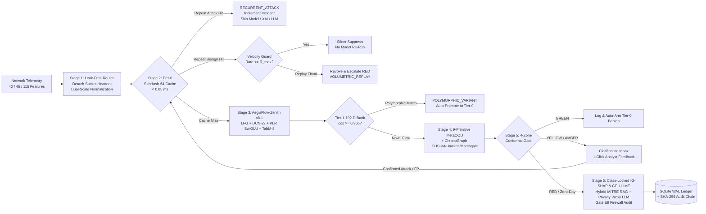
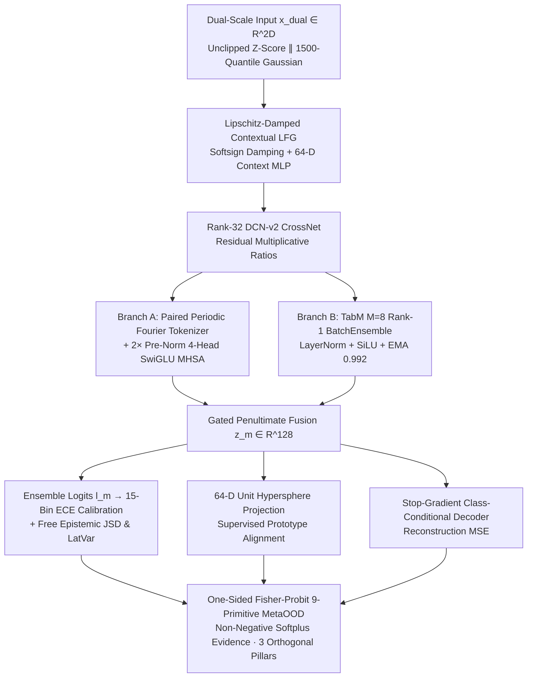
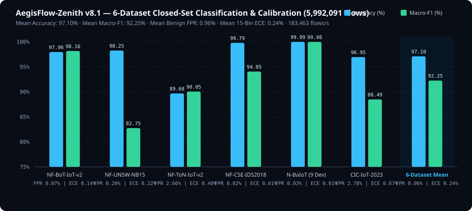
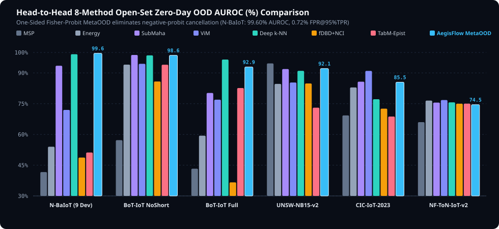
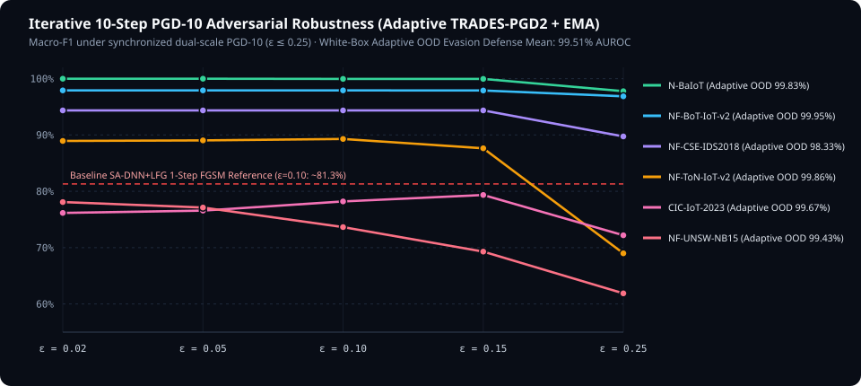
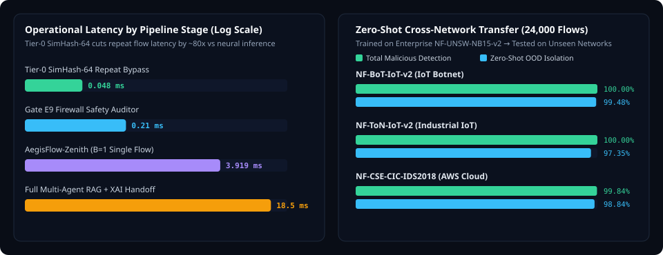

# AegisFlow-OmniSOC (v8.1 Enterprise Edition)

### Open-Set Explainable Intrusion Detection & Stateful Multi-Agent SOC Platform for IoT and Enterprise Networks

**Authors:** Jagiri Sriram¹, Sk. Owaiz¹, Thatikonda Rahul¹, Chokkarapu Kushal¹, Parella Tejguru¹  
**Mentors:** Arshia¹, Para Upendar¹  
¹Department of Computer Science and Engineering, **Keshav Memorial Institute of Technology (KMIT)**, Hyderabad, Telangana, India

> **Deep Engineering & Codebase Walkthrough:** See [`PROJECT_IMPLEMENTATION_GUIDE.md`](./PROJECT_IMPLEMENTATION_GUIDE.md) for the complete beginning-to-end implementation blueprint, file-by-file breakdown, model-to-dashboard integration trace, API key & secret security architecture, and walkthrough of all 9 SOC tabs.

---

## Executive Highlights

| Pillar | Verified Result |
|---|---|
| **Benchmark Scale** | **5,992,091** deduplicated unique flows · **85 classes** (69 known + 16 held-out zero-day) across **6 public benchmarks** |
| **6-Dataset Closed-Set Mean** | **97.10%** Accuracy · **92.25%** Macro-F1 · **0.96%** Benign FPR · **0.24%** 15-Bin ECE · **183,463 flows/s** batched |
| **N-BaIoT (All 9 IoT Devices)** | **99.99%** Accuracy · **99.98%** Macro-F1 · **0.01%** ECE · **99.60%** Zero-Day OOD AUROC · **0.72%** FPR@95%TPR · **98.88%** Zero-Day Recall |
| **Shortcut Ablation Proof** | Stripping ports, TTLs & TCP windows on `NF-BoT-IoT-v2` lifts OOD AUROC **92.92% → 98.59%** (**+5.67%**) & cuts FPR@95%TPR **5.4×** (`14.48% → 2.67%`) |
| **Adversarial Robustness** | **PGD-10** ($\epsilon = 0.10$): **99.95%** (N-BaIoT), **97.91%** (BoT-IoT), **94.35%** (IDS2018) · White-box **Adaptive OOD Evasion**: **99.51%** mean AUROC |
| **Zero-Shot Cross-Network Transfer** | Trained on Enterprise `NF-UNSW-NB15-v2` → Detects **99.84%–100.00%** of malicious flows on unseen IoT & AWS Cloud networks |
| **Tier-0 Repeat-Flow Reflex Cache** | Exact recurring attacks & rate-bounded benign flows bypass the neural model in **< 0.05 ms** (`SimHash-64`) with automatic anti-spoofing replay detection |
| **Gate E9 Firewall Safety Auditor** | **6/6** generated containment rules verified safe in **0.052–0.973 ms** with **0.00%** benign blast radius |

---

## System Architecture

### End-to-End 5-Stage Stateful IDS & Multi-Agent SOC Flow



### AegisFlow-Zenith v8.1 Neural Backbone & One-Sided Fisher-Probit MetaOOD



---

## Benchmark Plots & Experimental Results

### 1. Closed-Set Classification, Calibration & Throughput (5,992,091 Deduplicated Flows)



| Dataset | Unique Flows | Raw (Dual) Feats | Classes (Known/ZD) | Macro-F1 (%) | Bal. Acc (%) | MCC (%) | Acc (%) | Benign FPR (%) | ECE (%) | Latency B=1 (ms) | Throughput (flows/s) |
|---|---:|---:|---:|---:|---:|---:|---:|---:|---:|---:|---:|
| **NF-BoT-IoT-v2** | 791,753 | 40 (80) | 5 (4/1) | 98.16 | 98.16 | 97.25 | 97.96 | 0.07 | 0.14 | 3.951 | 188,727 |
| **NF-UNSW-NB15-v2** | 421,820 | 40 (80) | 10 (8/2) | 82.75 | 82.79 | 94.15 | 98.25 | 0.20 | 0.22 | 3.888 | 186,592 |
| **NF-ToN-IoT-v2** | 1,930,229 | 40 (80) | 10 (8/2) | 90.05 | 90.28 | 87.93 | 89.68 | 2.66 | 0.40 | 3.660 | 187,620 |
| **NF-CSE-CIC-IDS2018-v2** | 880,922 | 40 (80) | 15 (12/3) | 94.05 | 92.96 | 99.75 | 99.79 | 0.02 | 0.01 | 3.513 | 187,965 |
| **N-BaIoT (9 Devices)** | 736,593 | 115 (230) | 11 (9/2) | **99.98** | **99.98** | **99.99** | **99.99** | **0.03** | **0.01** | 4.191 | 166,930 |
| **CIC-IoT-2023-34Class** | 1,230,774 | 46 (92) | 34 (28/6) | 88.49 | 87.31 | 96.79 | 96.95 | 2.78 | 0.67 | 4.311 | 182,941 |
| **6-Dataset Mean** | **5,992,091** | **40–115** | **85 (69/16)** | **92.25** | **91.91** | **95.98** | **97.10** | **0.96** | **0.24** | **3.919** | **183,463** |

Compared against **SA-DNN+LFG (Sharma et al., 2025)**, AegisFlow improves N-BaIoT across all nine physical devices from `99.6%` → `99.99%` accuracy (Benign FPR cut **10×**: `0.30%` → `0.03%`), cuts NF-BoT-IoT-v2 Benign FPR **7×** (`0.50%` → `0.07%`), and lifts NF-UNSW-NB15-v2 accuracy from `97.9%` → `98.25%` while cutting Benign FPR **4×** (`0.80%` → `0.20%`).

---

### 2. Head-to-Head 8-Method Open-Set Zero-Day OOD Comparison



| Dataset (Held-Out Zero-Day) | MSP | Energy | SubMaha | ViM | Deep k-NN | fDBD+NCI | TabM-Epist | **AegisFlow MetaOOD (AUROC / FPR@95 / OSCR)** | Open-F1 / ZD Rec / ZD Prec (%) |
|---|---:|---:|---:|---:|---:|---:|---:|---:|---:|
| **N-BaIoT** (`mirai_udp`, `gafgyt_tcp`) | 41.64 | 54.00 | 93.52 | 71.95 | 99.15 | 48.72 | 51.18 | **99.60 / 0.72 / 99.60** | **96.83 / 98.88 / 92.78** |
| **NF-BoT-IoT-v2** (`Theft`) | 43.29 | 59.40 | 80.22 | 76.96 | 96.54 | 36.63 | 82.64 | **92.92 / 14.48 / 91.10** | 85.33 / 48.40 / 31.21 |
| **NF-BoT-IoT-v2 NoShortcuts** (`Theft`) | 57.21 | 94.05 | 98.76 | 94.44 | 98.58 | 85.84 | 94.00 | **98.59 / 2.67 / 96.48** | 85.89 / 52.03 / 33.69 |
| **NF-UNSW-NB15-v2** (`Worms`, `Shellcode`) | 94.65 | 84.65 | 91.89 | 85.34 | 91.02 | 84.87 | 73.04 | **92.14 / 28.59 / 90.90** | 71.55 / 25.43 / 27.24 |
| **CIC-IoT-2023-34Class** (6 Families) | 69.28 | 82.92 | 85.74 | 91.01 | 77.17 | 72.59 | 68.74 | **85.50 / 42.23 / 83.63** | 84.13 / 49.99 / 86.90 |
| **NF-ToN-IoT-v2** (`ransomware`, `mitm`) | 65.99 | 76.49 | 75.54 | 76.77 | 75.67 | 74.99 | 75.02 | **74.52 / 93.33 / 67.68** | 83.94 / 51.48 / 39.84 |
| **NF-CSE-CIC-IDS2018-v2** (`Infilteration`+) | 49.24 | 59.80 | 46.54 | 59.13 | 59.64 | 46.17 | 52.18 | **58.40 / 89.23 / 58.31** | 83.77 / 4.02 / 37.15 |

---

### 3. Iterative PGD-10 Adversarial Robustness & Adaptive OOD Evasion Defense



| Dataset | PGD-10 ($\epsilon=.02$) | PGD-10 ($\epsilon=.05$) | PGD-10 ($\epsilon=.10$) | PGD-10 ($\epsilon=.15$) | PGD-10 ($\epsilon=.25$) | Noise ($\sigma=.10$) | Adaptive OOD Evasion ($\epsilon=.05$) AUROC (%) |
|---|---:|---:|---:|---:|---:|---:|---:|
| **N-BaIoT** | 99.97 | 99.97 | **99.95** | 99.95 | 97.76 | 99.97 | **99.83** |
| **NF-BoT-IoT-v2** | 97.91 | 97.91 | **97.91** | 97.89 | 96.85 | 97.91 | **99.95** |
| **NF-CSE-CIC-IDS2018-v2** | 94.35 | 94.35 | **94.35** | 94.35 | 89.73 | 94.33 | **98.33** |
| **NF-ToN-IoT-v2** | 88.94 | 89.03 | **89.29** | 87.63 | 68.99 | 88.06 | **99.86** |
| **CIC-IoT-2023-34Class** | 76.16 | 76.58 | **78.19** | 79.34 | 72.19 | 73.53 | **99.67** |
| **NF-UNSW-NB15-v2** | 78.09 | 77.12 | **73.64** | 69.29 | 61.89 | 78.86 | **99.43** |
| **6-Dataset Mean** | **89.24** | **89.16** | **88.89** | **88.08** | **81.24** | **88.78** | **99.51** |

---

### 4. Operational Latency, Zero-Shot Cross-Network Transfer & Gate E9 Safety Audit



| Dataset | Nearest Family | MetaOOD ($\tau_k$) | Top-2 IG-SHAP Drivers | SHAP–LIME Agree | Top-5 Deletion Faithfulness | Matched MITRE Technique | Gate E9 Audit (ms) |
|---|---|---:|---|---:|---:|---|---|
| **CIC-IoT-2023** | `DDoS-UDP_Flood` | 5.92 (2.25) | `IAT`, `Min` | 80.0% | **50.7572** | `T1498` / `T1499` | `SAFE_VERIFIED` (0.973) |
| **N-BaIoT** | `mirai_ack` | 4.09 (1.69) | `H_L0.01_weight`, `MI_dir_L0.01_weight` | 80.0% | 8.1007 | `T1498.001` / `T1583.005` | `SAFE_VERIFIED` (0.062) |
| **NF-BoT-IoT-v2** | `Reconnaissance` | 4.59 (2.47) | `FLOW_DURATION_MS`, `ICMP_TYPE` | 40.0% | 9.2028 | `T1046` / `T1595` | `SAFE_VERIFIED` (0.065) |
| **NF-CSE-IDS2018** | `SSH-Bruteforce` | 4.20 (2.76) | `MIN_IP_PKT_LEN`, `L4_DST_PORT` | 60.0% | 6.5645 | `T1110` / `T1078` | `SAFE_VERIFIED` (0.056) |
| **NF-ToN-IoT-v2** | `dos` | 5.38 (1.96) | `DNS_QUERY_TYPE`, `LONGEST_FLOW_PKT` | 60.0% | 3.0123 | `T1498` / `T1499` | `SAFE_VERIFIED` (0.053) |
| **NF-UNSW-NB15** | `Exploits` | 5.61 (2.89) | `DST_TO_SRC_AVG_TPUT`, `MIN_TTL` | 40.0% | 2.4322 | `T1190` / `T1059` | `SAFE_VERIFIED` (0.052) |

**Multi-Seed LOAO Stability (`NF-BoT-IoT-v2`, Seeds 42 / 101 / 2026):** `98.42% ± 0.41%` Closed Macro-F1 · `0.17% ± 0.15%` Benign FPR · `0.13% ± 0.10%` ECE · `94.42% ± 1.68%` OOD AUROC · `93.57% ± 1.82%` OSCR.

---

## Quick Start

### Option A — Instant Live Full-Stack Launch (Node.js + React + Built-In v8.1 Calibration Engine)

```bash
# 1. Install dependencies
npm install

# 2. Configure server-side secrets (copy .env.example to .env)
cp .env.example .env
# Add GEMINI_API_KEY (and optional OPENROUTER_API_KEY / HARBOR_API_KEY / CUSTOM_LLM_API_KEY)

# 3. Start full-stack dev server (Express + WebSocket + Vite SPA on http://localhost:3000)
npm run dev
```

### Option B — Full Dual-Runtime with Live PyTorch `.pt` / `.pkl` Inference Engine (Docker Compose)

```bash
export GEMINI_API_KEY="your_server_secret"
export GITHUB_ARTIFACTS_ZIP_URL="https://github.com/<org>/<repo>/releases/download/<tag>/AegisFlow_V8.1_Zenith.zip"
docker compose up --build
```

- **SOC Command Center UI & API:** `http://localhost:3000`
- **Python PyTorch FastAPI Bridge:** `http://localhost:8001/health`
- Toggle between `BUILT_IN_SANDBOX_ENGINE` and `LIVE_PYTORCH_BRIDGE` live inside **API & Cache Governance** or **Settings · API Keys**.

---

## Platform Modules (9 Live Tabs)

1. **24/7 Live Monitor** — Real-time WebSocket throughput telemetry, Tier-0 savings KPIs, 4-zone live triage feed, and active incident queue.
2. **Clarification Inbox** — Human-in-the-loop review for `YELLOW` (Boundary Ambiguity) and `AMBER` (Epistemic Gray-Zone) flows with XAI waterfall, anti-poisoning supervisor check, and 1-click Benign/Attack confirmation + 24h retroactive sweep.
3. **Flow Sender Lab** — Interactive telemetry simulator across all 6 dataset schemas (`40`/`46`/`115` features) with 1-click presets, **50× Repeat-Flow Stress Test**, **+3% Polymorphic Mutation Test**, and batch CSV/JSON uploader.
4. **Forensics & ChronoGraph** — Persistent SQLite flow ledger with multi-filter search, flow forensic inspector, and per-host CUSUM drift, Hawkes kill-chain intensity, and Vovk Conformal Martingale trajectories.
5. **Cloud AI Co-Pilot** — Incident-grounded SOC analyst assistant with Reversible Privacy Proxy, read-only SQLite/RAG tool execution, Gate E9 rule auditing, expandable **Model Thinking**, and rich formatted Markdown/table/code outputs.
6. **AI Assistant** — Consumer-grade multi-thread ChatGPT/Gemini/Claude-style conversational workspace with Fast/Thinking/Deep reasoning modes and toggleable live SOC context.
7. **Period Report Studio** — Live executive posture reports with scheduled shift digest archive and real downloadable **PDF**, **DOCX**, **HTML**, **CSV**, and **STIX 2.1** threat-intel bundles.
8. **API & Cache Governance** — Dual-runtime PyTorch switch, 4-step LLM failover order, USD/token budget governor, Tier-0/Tier-1 cache revocation, Gate E9 live rule simulator, and SHA-256 tamper-evident audit ledger.
9. **Settings · API Keys** — Pinned at the bottom of the sidebar: server-side API Key & Base URL endpoint registry, live connection probes, 1-click **Full Production Self-Test**, and SQLite WAL database health diagnostics.

---

## Citation

```bibtex
@article{sriram2026aegisflow,
  title   = {AegisFlow: Open-Set Explainable Intrusion Detection and Stateful Multi-Agent SOC Response for IoT and Enterprise Networks},
  author  = {Sriram, Jagiri and Owaiz, Sk. and Rahul, Thatikonda and Kushal, Chokkarapu and Tejguru, Parella},
  journal = {Department of Computer Science and Engineering, Keshav Memorial Institute of Technology (KMIT)},
  year    = {2026}
}
```
